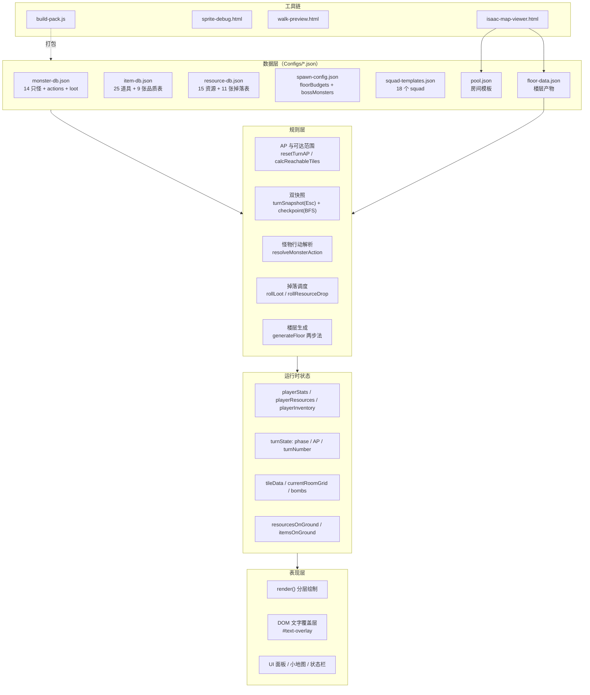

# 以撒·半回合制战斗 — GDD 设计梳理（四阶段）

> **文档性质**：本文档是**设计层面的自查梳理**，不是实现说明书。目的是反向检查设计本身是否成立。
> 已实现内容的介绍、技术常量、函数索引请看 `isaac-turnbase-context.md`；决策演变过程见 `isaac-memory.md`。
>
> **标注约定**：
> `✅ 已实现` ／ `🟡 设计中·未实现` ／ `⚪ 缺失（未设计）` ／ `⚠️ 风险（已实现但存在设计问题）` ／ `[待补充]` ／ `[待核实]`
>
> **重要免责**：本次梳理**未逐行阅读 `isaac-turnbased-demo2.html` 源码**（约 3900 行），所有「已实现」判断均基于 `isaac-turnbase-context.md` + `isaac-memory.md` 的记载。凡涉及代码内部行为的结论，一律标注 `[待核实]`。
>
> **梳理日期**：2026-10-26

---

## 0. 一页速览

### 0.1 一句话概念

受《以撒的结合》启发的 Roguelike 半回合制地牢战斗原型：玩家在自己的回合内用 **MP（移动点）** 即时移动、用 **AP（攻击点）** 即时射击，随时可按 **Esc 把整个回合完全撤销**；清房间 → 打 Boss → 下 3 层通关。

### 0.2 四阶段成熟度

| 阶段 | 成熟度 | 判断依据 |
|---|:--:|---|
| ① 概念 | ★★★★☆ | 定位/双模式/核心创新点清晰；缺目标用户与单局时长 |
| ② 顶层设计 | ★★★☆☆ | 取舍记录极丰富（10+ 条，含理由与被否决方案），但内容体量从未正式固化，且你自己已识别出 4 个循环级缺口 |
| ③ 架构设计 | ★★★★☆ | 配置外置做得最扎实（6 份 JSON + 分类原则）；短板是状态快照高度脆弱、无测试 |
| ④ 系统设计 | ★★★★★ | 16 个子系统规则完整、参数外置、边界处理细致，是四阶段中最成熟的 |

### 0.3 最需要你先看的 3 个设计风险

**R1 — 你自己已识别的 4 个循环级缺口仍未闭环**
`memory 2026-08-07` 记录了你的原话指正：**金币只有商店一个消费出口**（资源管理乐趣实际不存在）、**探索深度不足**（只是战斗之间的过渡）、**25 种道具纯数值叠加、构筑感弱**、**战斗最优解过于明显**（走到安全位置 → 射完子弹 → 结束回合）。这四条直接决定"游戏好不好玩"，但目前只有优化方向建议，**没有任何一条被采纳或否决**。

**R2 — 双快照机制是架构级脆弱点，且已经实际造成了 3 次 bug**
Esc 全重置（`turnSnapshot`）+ BFS checkpoint（`saveCheckpoint`）两套机制各自手写保存/恢复状态，共 6 处保存点。已发生：`liftDir` 在 6 处中漏 1 处 → `liftY = NaN` → 资源视觉消失（2026-07-30）；`_groundResources` 深拷贝断了引用 → 幽灵资源（2026-07-31）；地形/炸弹未纳入快照 → 回溯不完整（2026-07-30）。**每新增一个状态字段，都要人工补齐所有快照点**，漏一个就是一个 bug。

**R3 — Godot 迁移成本被低估**
`context` 宣称目标平台是 Godot，但当前实现有三处 Web 专有依赖无法直接迁移：①DOM 文字覆盖层（`#text-overlay`，因 Canvas `image-rendering:pixelated` 导致文字不可读而引入）；②File System Access API（地图编辑器直读直写 JSON）；③全部逻辑与渲染耦合在单文件 3900 行内。迁移不是"翻译代码"，而是"重新分层"。

---

## 第一部分 概念阶段

### 1.1 现状（事实）

| 维度 | 现状 | 来源 |
|---|---|---|
| 类型 | Roguelike 半回合制地牢战斗 | concept §1.1 |
| 平台 | 原型：网页 Canvas（318×186，CSS 放大 3 倍） | concept §1.1 §2.1 |
| 宣称目标平台 | Godot 引擎 | concept §1.1；状态 `⚪ 未启动` `[待补充]` |
| 视角 | 2D 俯视（标准矩形，透视已取消） | concept §2.9 |
| 核心概念 | 半回合制 + AP 行动点数双资源池 + Esc 全回溯；探索/战斗两套操作逻辑 | concept §1.2 |
| 玩法动词 | 探索移动 / 回合内即时移动 / 即时射击 / 结束回合 / 撤销回合 / 拾取 / 放置炸弹 / 开门 / 切换楼层 | concept §3.1 |
| 核心循环 | 探索 → 战斗 → 成长（叠属性/攒资源）→ 推进（清房 → Boss → 下一层） | memory 2026-08-07 |
| 单局结构 | 3 层地牢，每层 8~15 房，通关 = 3 层全清 | concept §2.8 §4 |
| 单局时长 | **无设定** `[待补充]` | — |
| 失败处理 | HP 归零 → 按 R 回到第 1 层起点（重开） | concept §3.1 |
| 差异化 | AP 驱动即时操作回合制 + Esc 全回溯（memory 记录 AI 评估为「有辨识度的创新点」） | memory 2026-08-07 |
| 内容体量 | 14 只怪（5 类型）/ 25 道具 / 6 种 TILE / 18 个 squad / 11 种 action / 9 张道具表 + 11 张资源表 | concept §1.5 §2.7 §2.12 §2.16 |

### 1.2 缺口与建议（我的判断）

- **⚪ 目标用户缺失**。文档从未回答做给谁玩。这对本项目影响尤其大：`memory 2026-08-07` 明确记录「上手门槛较高（概念密度大、按键多）」—— 如果目标是轻度玩家，MP/AP 双资源池 + Esc 回溯 + 6 键操作就是超载；如果目标是硬核策略玩家，那么"最优解明显"才是主要问题。**这两个方向的改法完全相反，不定义用户就无法判断该往哪走。** `[待补充]`
- **⚪ 单局时长缺失**。3 层 × 8~15 房 + 14 种怪 + Boss 战，一局多长没有预期。没有时长目标就无法判断「每层 8~15 房」是否合理，也无法判断 Roguelike 的单局重开成本是否可接受。`[待补充]`
- **⚠️ 概念阶段的两条设计目标偏"技术验证"，不偏"体验"**。§1.4 原文是「探索将 Roguelike 回合制与 AP 行动点数预操作结合的可行性」「用纯 Canvas 像素绘制快速验证核心玩法」—— 这两条都是**手段**（怎么验证），不是**目标**（要让玩家获得什么体验）。这不是错误，但意味着本项目至今**没有一句关于"玩家应该感到什么"的表述**，这正是第②阶段支柱空心的根因。
- **✅ 概念阶段的差异化是真实的**。「回合内即时操作 + 全回溯」确实不是常见组合：传统回合制是"先规划后执行"，本项目是"边试边撤"。这个卖点成立，问题在于没有被充分利用（见第②阶段）。

---

## 第二部分 顶层设计

### 2.1 现状（事实）

#### 设计支柱（2 条，原文为「设计目标」）

| # | 支柱 | 原文 |
|---|---|---|
| P1 | 验证「Roguelike 回合制 + AP 行动点数」结合的可行性 | §1.4 |
| P2 | 用纯 Canvas 快速验证核心玩法 | §1.4 |

> 注：这两条是**验证目标**而非**体验支柱**（见 §1.2 末条）。项目内没有关于"体验支柱"的表述。

#### 核心循环

| 层级 | 现状 |
|---|---|
| 局内（单回合） | `player_select`（MP 移动 / AP 射击 / Esc 撤销 / Space 结束）→ `monster_turn`（炸弹倒计时 → 怪物行动 → 碰撞与尖刺）→ 循环 |
| 单局（一局游戏） | 起点房 → 探索清房 → 宝箱房取道具 → 商店买道具 → Boss 房 → 梯子下一层 → 重复 3 层 → 胜利 |
| 长期（跨局） | **无**（无 meta 解锁、无角色差异、无局外成长） |

#### 关键设计取舍（有据可查，共 12 条）

**① 预操作队列 → 即时操作 + 快照** `[2026-07-15]`
- 旧方案：玩家先规划整回合所有操作（移动队列 + 射击方向），Space 统一执行，执行中无暂停机会。
- **理由**：预操作队列体验差、缺乏容错能力，玩家无法在执行中调整决策。
- 新方案：WASD 即时移动本体 + ↑↓←→ 即时射击 + Esc 全重置（快照 `saveTurnSnapshot` / `restoreTurnSnapshot`）。
- **这是本项目最根本的一次转向，Esc 全回溯能力是从这里长出来的。**

**② 移除击退 / 反弹** `[2026-07-21]`
- 删除 `tryPushPlayer()` / `tryPushMonster()`，碰撞统一为「受伤 + 共格」，无推击反弹。
- 配套：轨迹系统 `turnMovePath` 记录每步 `{col,row,invincibleSteps}`，支持曼哈顿回溯（后退超过接触步 → 回血 + 回无敌；离开怪物格不撤销）。
- **注**：这条在 memory 中被标注为「用户澄清两次才定案」，属于反复沟通后确立的方案。

**③ HP 6 → 3 心制，全部伤害减半** `[2026-07-20]`
- 血量上限 6 → 3 颗心，支持半心；所有玩家伤害减半（普通怪 0.5 心 / 高级怪+Boss+尖刺 1 心）。
- 总上限 = 红心 + 蓝心 = **12**（`MAX_TOTAL_HEARTS`），红心上限提升优先于蓝心（满时替换蓝心）。
- **理由（memory 记载）**：心形血条在视觉反馈上更符合以撒风格。

**④ 无敌系统统一为步数制** `[2026-07-20]`
- 旧方案：战斗模式 `invincibleTurns`（3 回合）+ 探索模式 `invincibleSteps`（移速×2 步）两套并存。
- **理由**：战斗↔探索切换时无敌持续逻辑不一致。
- 新方案：统一 `invincibleSteps = 移速 × 2`；结束回合时未消耗的 MP 也计入消耗（只读，不改 AP 系统）。

**⑤ Checkpoint 时机：从"发射瞬间"改为"实际效果发生"** `[2026-07-31]`
- 旧方案：子弹生成的瞬间就 `saveCheckpoint()`。
- **问题**：之后的弹道飞行 → 命中 → 怪物死亡 → 掉落 这一整套结果都没写进 checkpoint，BFS 回退会"吐出"已发生的结果。
- 新方案：射击时不存；改为「怪物非致命命中 / 击杀 / 地形破坏 / 房间清空」时保存。
- **设计原则确立**：checkpoint 必须反映「操作的实际结果」，而非「操作开始的瞬间」。

**⑥ 炸弹模式融入战斗模式** `[2026-07-29]`
- 旧方案：独立 `bombMode` 状态 + 独立 Space 分支 + 探索模式专属炸弹回合（只有 MP 不能射击）。
- 新方案：放置炸弹即 `inCombat = true`，走统一战斗流程；倒计时移到 `startMonsterTurn()` 最开头（优先级高于所有怪物）；门锁只判断怪物存活，不判断炸弹。
- **理由**：炸弹不应是特殊模式，应作为战斗的一部分。副产品：炸弹房可以自由移动射击。

**⑦ 配置外置的分类原则** `[2026-07-23]`
- **判断标准：策划日常需要调整的值 → JSON；引擎/渲染/算法内部调参 → 代码。**
- 应外置（已做）：怪物 AI 行为参数 → `monster-db.json`
- 明确保留在代码里：渲染常量（CELL/WALL/COLS/ROWS/子弹速度/重力/粒子重力）、动画时长、刷怪算法内部权重（floorBonus×2、role 权重×3、提前停止阈值 30%）
- **这是本项目最值得肯定的一条设计纪律**，它解释了为什么 6 份 JSON 能覆盖 90% 的策划数据。

**⑧ 怪物 AI 三次重构（结构演进全过程）**
| 代 | 时间 | 结构 | 问题 |
|---|---|---|---|
| v1 | 2026-07-24 | `movement: {mode, steps, stepMode, weight}` + `aiType` + `aiParams` | 移动方向与 AI 参数分属两个对象，配置分散 |
| v2 | 2026-07-27 | `actionMode{mode,weights}` + `actions[]`（每个 action 自带全部参数） | 解决了参数分散 |
| v3 | 2026-07-28 | 新增 `actionMode: "condition"` + `condition(in_range/out_of_range)` + `after_effect` | 让行为由局势驱动而非纯随机 |

**⑨ 刷怪：三层算法 → squad 模板系统**
- v1 `[2026-07-16]`：标签过滤 → 组合规则（至少 1 近战 + 多样性加权×3）→ 点数预算（budget + (楼层-1)×2）
- v2 `[2026-08-05]`：改为预定义 squad 模板（18 个组合）+ 锚点聚拢生成
- **理由（memory）**：旧方案按怪物独立选取，缺乏"怪物组合"的概念。
- v3 `[2026-08-05]`：锚点距离=1 无空格时**换锚点重选**，去掉 topN 退路（避免 squad 分裂）

**⑩ 楼层生成两步法** `[2026-07-22]`
- 旧方案：所有房间一起布局后再分配类型 → Boss/宝箱可能落在集群中间 → 需要裁边 + 连通性修复 → 图可能断开需要回退。
- 新方案：骨架房（起点+普通）先布局并全连通 → Boss 从边界最远空位挂载、宝箱从剩余边界随机挂载。
- **收益**：Boss/宝箱天然只有 1 个连接，裁边/连通性修复代码全部删除。

**⑪ 地形掉落预 roll，保证回溯一致** `[2026-07-30]`
- 房间初始化时为每个 POOP/ROCK **预 roll** 掉落并存 `_loot`；破坏时用预 roll 结果。
- **理由**：否则 ESC 回溯后再次破坏同一地形会重新随机，掉落不一致。
- 与怪物击杀掉落 `_killLoot` 采用同一模式。

**⑫ 编辑器去服务器** `[2026-07-20]`
- 尝试过 Node `server.js` / PowerShell / Python / `<form>` POST，全部失败或被代理拦截。
- 最终：File System Access API 直读直写 + "生成json"按钮手动复制 + IndexedDB 持久化文件句柄。
- **理由**：不装 Node/Python 时最可靠。

#### 进度与内容体量

| 项 | 现状 | 备注 |
|---|---|---|
| 楼层数 | **3 层** | memory 记载曾文档误写 6 层，已修正 |
| 每层房间 | 8~15 房，BFS 全连通 | concept §2.8 |
| 房间类型 | start / normal / treasure / boss / shop | 5 种 |
| 难度递进方式 | `spawn-config.json` 按层配 `floorBudgets{minMonsters,maxMonsters,budget}` + `terrainModifiers` 按模板偏移 | 纯配置驱动 |
| Boss 编排 | 第 1 层 Boss Jumper；第 2 层苍蝇公爵；第 3 层公爵 + 双 Jumper 连战（squad 已有 `boss_duke_and_jumper_i` / `_iii`） | `[待核实]` 第 3 层实际使用哪个 squad |
| 成长途径 | 仅道具（25 种，数值叠加）+ 资源（金币/炸弹/心/钥匙） | 无等级、无技能树 |
| 平衡基准 | 怪物数值、掉落概率均为人工粗调（memory：「后续会手动微调数值，本次为粗略调整建立框架」） | 无数据支撑 |

### 2.2 缺口与建议（我的判断）

> 本节前四条**全部来自你自己的判断**（`memory 2026-08-07`），不是我的臆测。

- **⚠️【你已识别】金币只有商店一个消费出口**
  原文：「当前原型中金币的'资源管理'乐趣实际不存在」。推导：金币唯一出口是商店，而商店商品由 `resource_drop_shop_stock` 随机生成、价格固定 → 玩家没有"该不该花、什么时候花"的取舍，只有"钱够不够"的是非判断。**这使资源系统从"管理"退化为"计数"。**

- **⚠️【你已识别】探索深度不足**
  原文：「目前只是战斗之间的过渡，没有自己的玩法深度」。推导：探索模式只有三件事——走路、开门、踩梯子；且已访问房间不再刷怪 → 探索退化为"走廊"。P1 支柱里"Roguelike"的部分（探索风险/回报、路线选择）实际没有实现。

- **⚠️【你已识别】25 种道具纯数值叠加，构筑感弱**
  推导：25 道具中 22 种只改 `maxHp/attack/fireRate/moveSpeed/range` 五个数值，仅 3 种特效（穿透 / 伤害倍率 / 满血回复）。→ 玩家拿道具时不需要做任何取舍（都是纯增益、无代价），"构筑"不存在，只有"数值堆叠"。**Roguelike 的核心爽点（本次构筑与上次不同）因此缺失。**

- **⚠️【你已识别】战斗最优解过于明显**
  原文：「走到安全位置→射完子弹→结束回合，缺乏回合内真正决策分支」。这是对 P1 支柱最直接的否定：如果每回合都有唯一最优解，那么 AP 与 Esc 回溯提供的"自由度"就只是**操作上的自由**，不是**策略上的自由**。

- **⚠️ 上述四条互相强化，不能单独修**。举例：单加"金币第二个出口"无法产生资源管理乐趣，因为玩家仍不需要做取舍（道具全是纯增益）；单加"质变道具"也无法产生构筑感，因为道具获取是随机的、没有选择权（宝箱开着给什么拿什么、商店价格固定）。四条是同一个问题的四个面：**系统很多，但没有一个是"需要玩家做不可逆选择"的**。

- **⚪ 内容体量从未正式固化**。3 层 / 8~15 房 / 14 怪 / 25 道具 / 18 squad，这些数字全部是逐次迭代中长出来的，文档里没有任何一处写"这就是最终体量"。后果：无法判断内容量是否支撑单局时长，也无法判断"25 道具"够不够做构筑（对比以撒本体 ~700 道具）。
- **🟡 运气属性存在但无功能**。属性表列「运气 0，影响掉落/暴击等（未实现）」，属于占位。`[待补充]` 是否继续做。
- **⚪ Godot 迁移目标未启动**，且当前架构有 Web 专有依赖（见 R3）。这是"宣称目标"与"实际路径"的脱节。`[待补充]` 是最终目标还是备选。
- **✅ 值得肯定：配置外置纪律是四个项目里执行最彻底的**。6 份 JSON + 「策划值 vs 引擎值」的分类原则，且该原则被记录并可复用。这条纪律让调参不需要改代码，是 4 个系统（怪物/道具/资源/刷怪）能快速迭代的前提。

---

## 第三部分 架构设计

### 3.1 现状（事实）

#### 总体结构

单文件 HTML（`isaac-turnbased-demo2.html`，约 3900 行），内含 CSS + HTML + 全部 JS。逻辑与渲染耦合在同一作用域，靠约定分层。`[待核实：具体行数]`



#### 分层职责

| 层 | 内容 |
|---|---|
| 数据层 | 6 份 JSON 配置 + 1 份楼层产物（`floor-data.json`），全部异步 fetch 加载（`loadMonsterDB` / `loadItemDB` / `loadResourceDB` / `loadSpawnConfig` / `loadSquadTemplates` / `loadTemplates` / `loadOrGenerateFloors`） |
| 状态层 | `playerStats` / `playerResources` / `playerInventory` / `turnState{phase, mAP, aAP, hasShot, reachableTiles, turnNumber}` / `tileData` / `currentRoomGrid` / `bombs` / `resourcesOnGround` / `itemsOnGround` / `allFloors` |
| 规则层 | AP 与 BFS 可达 / 回合快照与 checkpoint / 怪物行动解析与 AI 路由 / 掉落统一调度 / 楼层生成 / 道具属性重算 `recalcAllStats` |
| 表现层 | `render()` 分层绘制（墙壁→地板→TILE→门→网格→可达范围→子弹→粒子→资源→炸弹→怪物→角色→动画）+ DOM 文字覆盖层 + UI 面板 |
| 工具层 | 地图编辑器（File System Access API 直读直写）/ 精灵调试 / 走路预览 / 打包脚本 |

#### 核心机制（架构级）

**1. 回合状态机**

```
player_select ──Space──→ monster_turn ──→ player_select
     │  ↑
     │  └── Esc（restoreTurnSnapshot + 时间倒流 0.35s）
     └── 内部 checkpoint（子弹命中/击杀/地形破坏/房间清空）
```

**2. 双快照机制（最关键的架构决策，也是最脆弱的地方）**

| 机制 | 触发 | 保存内容 | 恢复方式 |
|---|---|---|---|
| `turnSnapshot` | `resetTurnAP()` 每回合开始 | 玩家坐标/HP、怪物坐标/HP、道具库存、`playerStats` 全属性、蓝心、地上资源/道具、`tileData`、`currentRoomGrid`、炸弹、感叹号状态 | Esc → `restoreTurnSnapshot()`，全部回滚 |
| `checkpoint` | 子弹实际命中 / 击杀 / 地形破坏 / 房间清空 | 位置 + 怪物状态 + 资源/道具 + `invincibleSteps` + `liftDir` | BFS 路径重放时 `simulateFromCheckpoint()` 局部回滚 |

- **为什么需要两套**：Esc 要撤销"整回合"（包括移动轨迹），checkpoint 只需撤销"最后一次操作之后到当前位置"这段（因为移动是 BFS 范围内的自由行为，不该每次移动都重置）。
- **脆弱点**：两套机制各自手写保存/恢复，共 6 处保存点（`saveTurnSnapshot` / `saveCheckpoint` / `restoreCheckpoint` / `restoreCheckpointWithoutBullets` / `restoreTurnSnapshot` / `simulateFromCheckpoint`）。新增状态字段必须全部补齐。

**3. 预 roll 机制（保证回溯确定性）**
- 怪物击杀 `_killLoot`、地形破坏 `_loot` 在**生成时/初始化时**就把掉落 roll 好并缓存；回溯后再次触发时使用缓存结果。
- **设计原则**：随机性必须在回溯边界之外发生，否则"撤销再重来"会得到不同结果 → 回溯机制失去意义。

**4. 掉落统一调度器**
- `rollLoot(lootConfig, col, row)` 解析 entries/rounds，支持三种 mode：`pick_one`（按权重抽 1）/ `roll_all`（每项独立判定）/ `pick_first`（顺序判定首个成功）
- 分派到 `executeDropEntry` → `item` / `resource` / `resource_fixed` 三类
- `none` 权重参与总权重计算（2026-08-06 修过 bug：曾把 `none` 过滤掉导致"永不空掉"）

**5. 2×2 体型适配**
- `monsterCells()` / `isInMonsterFootprint()` / `isValidLandingZone()` 三个辅助函数，全系统适配（渲染中心偏移 `CELL*(sz-1)/2`、碰撞、快照、占用、DOM 标签）

### 3.2 缺口与建议（我的判断）

- **⚠️ 状态管理是最大架构风险**。状态散落在十余个全局变量中，`render()` 直接读取全局，快照靠手写清单。这是"小项目快速迭代"的合理选择，但已到临界点：
  - 已实际造成 3 次 bug（`liftDir` 漏 1 处 → NaN → 资源隐形但可拾取；`_groundResources` 深拷贝断引用 → 幽灵资源；地形/炸弹未入快照 → 回溯不完整）
  - 每新增一个状态字段，都要人工改 6 处 → **漏一处就是一个隐蔽 bug，且通常只在特定回溯路径下才暴露**
  - 这类 bug 的调试成本极高（`liftDir` 那个 bug 的因果链跨 6 个函数）

- **⚠️ 无配置 schema 校验**。6 份 JSON 全靠人工保证格式，已知踩坑：尾随逗号导致 `item-db.json` 解析失败（2026-07-31）、`_schema` 元数据 key 被当成模板合并导致编辑器报错（2026-08-05）、表名重命名后 6 个文件需要同步改（2026-08-04）。目前靠「编辑后跑 lint」的人工纪律兜底。

- **⚠️ 演示文件双轨是既有维护债务**。`demo.html`（内联 MONSTER 数据）与 `demo2.html`（JSON 加载）功能平行，memory 明确记录「双文件维护成本高，但 demo.html 是早期快照版本（用户明确保护不可删除），暂不合并」。当前 demo2 是唯一主开发文件，`demo.html` 实际已无需求 —— 但按文件保护规范不能删，会持续误导。

- **🟡 无任何自动化测试**。核心机制（快照/回溯/掉落确定性/BFS 可达/2×2 落地验证）全部依赖手动验证。这也是 R2 那批 bug 能被发现的唯一途径（玩家偶然碰到）。

- **⚠️ 表现层与 Web 平台强绑定**。`render()` 里同时有 Canvas 绘制和 DOM 覆盖层位置计算；文字全靠 `#text-overlay` DOM 层（因为 Canvas 像素缩放会把文字压成马赛克）。这套方案在 Web 上是对的，但它把"哪里画什么"和"用什么画"焊死在一起 → 迁移 Godot 时无法保留。

- **✅ 值得肯定**：`context §1 架构概览` 用注释树把 40+ 个函数按职责分组，是同类单文件项目里少见的可读性投入。

---

## 第四部分 系统设计

> 按「规则 / 数值 / 状态机 / 边界」组织，只写设计层面必要信息。技术实现见 `context §2`。

### 4.1 回合与 AP 系统 ✅

**双资源池（核心创新点）**

| AP | 上限来源 | 默认值 | 消耗 | 下限 |
|---|---|---|:--:|:--:|
| MP（移动） | `floor(移速)` | 3 | 每移动 1 格 | 1 |
| AP（攻击） | `floor(射速)` | 3 | 每次射击 | 1 |

- **两个池互相独立**（`memory 2026-08-07` 记录：AI 曾误述为"共享回合上限"被你指正）
- 每回合重置为满值；**不强制用完**（可保留任意点数结束回合）
- 道具改移速/射速 → AP 上限自动变化（`Math.floor` 向下取整保证整数步数）

**半回合制的确切定义（本项目必须写清的概念）**

| 阶段 | 玩家能做什么 | 时间性质 |
|---|---|---|
| `player_select` | 在 BFS 可达范围内**即时**移动、**即时**射击、随时 Esc 撤销、Space 结束 | 无时间压力（非实时），但操作即时生效（非队列） |
| `monster_turn` | 无输入 | 所有怪物同时逐步移动，0.15s/步，平滑插值 170px/s |

- **关键点**：玩家的所有操作都是**可撤销的试探**，只有按 Space 才"提交"。这是与《以撒》本体（实时）和传统回合制（规划后提交）都不同的第三种形态。

**状态机**

```
player_select ⇄ monster_turn     （Space 提交）
player_select → player_select    （Esc 撤销整回合）
monster_turn → player_select     （怪物行动结束，AP 重置）
```

**边界**
- Esc 不消耗任何资源、无次数限制（memory：误触代价低，不做保护）
- 结束回合时未消耗的 MP 计入 `invincibleSteps` 消耗（只读，不改 AP）

**设计观察（⚠️）**
- AP 的"上限由属性决定"这个设计意味着：**一切成长最终都换算成"每回合更多的行动次数"**。这带来一个隐性天花板 —— 道具变强 → AP 变多 → 回合内可做的事变多 → 但"该做什么"的决策质量没有变（见 4.11 道具系统）。

### 4.2 快照与回溯系统 ✅（⚠️ 架构脆弱）

| 机制 | 作用范围 | 触发 | 语义 |
|---|---|---|---|
| `turnSnapshot` | 整个回合 | 每回合开始 `resetTurnAP()` | 「完全重置本回合」 |
| `checkpoint` | 最后一次操作之后 | 命中/击杀/破坏/清房 | 「回退到上一个有效结果」 |

**回溯范围（已覆盖）**：玩家坐标/HP、怪物坐标/HP、`playerInventory`、`playerStats`、蓝心、地上资源、地上道具、`tileData`、`currentRoomGrid`、炸弹、蓄力感叹号状态、`invincibleSteps`、`turnMovePath` 各节点无敌值、资源/道具拾取日志

**回溯边界原则（隐含但重要）**
- 随机性必须在回溯边界外产生（预 roll 机制，见 4.12）
- checkpoint 反映"实际效果"而非"操作瞬间"（2026-07-31 修正）

**设计观察（⚠️）**
- 这套机制提供了极强的容错，但**它同时也削弱了风险感**：既然什么都能撤销，玩家就不会因"怕做错"而谨慎 → 这是 P1 支柱"策略深度"的一个隐性敌人。是否要加撤销成本（次数限制/代价），是一个未讨论过的设计问题。

### 4.3 房间与 TILE 系统 ✅

**房间规格**：13 列 × 7 行，格 22px，墙厚 16px，画布 318×186（CSS ×3 = 954×558）

**6 种 TILE**

| TILE | 字符 | 可行走 | 特性 |
|---|:--:|:--:|---|
| FLOOR | `.` | ✅ | 默认地面 |
| ROCK | `#` | ❌ | 挡路挡弹，hp=99（不可破坏） |
| POOP | `P` | ❌ | 可破坏 hp=4（4 发子弹），挡弹 |
| PIT | `_` | ❌ | 深渊，踩上即死 |
| SPIKE | `^` | ✅ | 玩家 1 心 / 怪物 5 HP |
| LADDER | `▼` | ✅ | Boss 房踩上进入下一层 |

**门系统**：每边正中 1 个门前格（上 6,0 / 下 6,6 / 左 0,3 / 右 12,3），必须为可通行地面；每房间最多 4 扇门；房间清怪后自动打开（`updateDoorsLocked` 只判断怪物，不判断炸弹）

**边界**：深渊 + 2×2 怪物落点验证（`isValidLandingZone`：不越界、不是墙、不能全深渊）

**设计观察（⚠️）**
- 6 种 TILE 里 **PIT 几乎是死代码**：只有 Boss Jumper 的落点验证会用到它（"不能全深坑"）。玩家的 BFS 可达范围算法天然不会走 PIT，所以"踩上即死"实际很难触发 → 深渊作为"环境威胁"没有承担起风险职责。
- SPIKE 是唯一有效的环境威胁（怪物经过 5 伤害、玩家 1 心），但它不改变玩家决策（能绕就绕，绕不过就吃伤害）。

### 4.4 多房间楼层系统 ✅

**结构**：3 层，每层 8~15 房，BFS 全连通校验；5 种房间类型（start / normal / treasure / boss / shop）

**生成算法（两步法，2026-07-22）**
1. 骨架房（起点 + 普通房）从所有已放房间的相邻空位扩展，直至全连通
2. Boss 从**集群边界最远空位**挂载；宝箱从剩余边界随机挂载
- **收益**：Boss/宝箱天然只有 1 个连接（始终在集群外围），无需裁边与连通性修复

**约束**：所有房间度数 ≤ 4；连接房间曼哈顿距离必须 = 1；至少 3 个叶节点（start/boss/treasure 各一）

**持久化**：`floor-data.json` 保存结构 + 房间 grid；加载时保留已存 grid（改 `pool.json` 不影响已有楼层）；`_initGrid` / `_initDoors` 深拷贝供 R 键重置

**设计观察（⚠️）**
- 楼层生成本身很扎实，但**玩家看不到"选择"**：路线只有一条（树状图，无环），房间类型由生成算法决定而非玩家选择 → 没有"走哪条路"的 Roguelike 核心决策。这是 §2.2「探索深度不足」在楼层层面的具体表现。
- 小地图（100×80px）已实现，但只显示"已探索/未探索/当前"，**不显示房间类型线索** → 无法支撑"根据信息做路线决策"。

### 4.5 探索模式与战斗模式 ✅

| 维度 | 探索模式 `inCombat=false` | 战斗模式 `inCombat=true` |
|---|---|---|
| 触发 | 房间无怪且无未引爆炸弹 | 有怪或有未引爆炸弹 |
| 移动 | WASD 自由移动（无 AP） | WASD 在 BFS 可达范围内移动（消耗 MP） |
| 射击 | ❌ | ✅（消耗 AP） |
| 门 | 门前格 + 方向键 → 切换房间（滑动过渡 400px/s） | 锁死 |
| 视觉 | AP 面板隐藏 | 交叉剑开场动画 0.55s |
| 已访问房间 | 不再刷怪 | — |

**设计观察（⚠️ 本条最关键）**
- **探索模式与战斗模式的玩法密度严重不对称**：战斗模式有 AP、有回溯、有 14 种怪物行为、有炸弹；探索模式只有移动和开门。
- 因为"已访问房间不再刷怪"，探索的实际体验是：**清完 → 空房间走廊 → 下一个房间**。探索没有风险、没有资源消耗、没有决策 → 它本质是"房间之间的加载动画"。
- 这正是 §2.2「探索深度不足」的机制根源。要让它成立，探索必须有**独立的资源**（时间/光照/耐久）或**独立的风险**（陷阱/单向门/不可回头），当前两者皆无。

### 4.6 子弹系统 ✅

| 属性 | 值 |
|---|---|
| 最大飞行距离 | 6.0 格（= 射程属性） |
| 飞行速度 | 560 px/s |
| 三阶段 | 飞行（匀速）→ 下落（水平减速 + 垂直加速，提前 0.2 格开始）→ 碎裂为粒子 |
| 下落参数 | 水平速度比例 7%，重力 1100 px/s² |
| 碎裂粒子 | 10 个，0.25s 淡出 |
| 伤害 | 3.5（攻击力） |

- 即时发射（按方向键立即从角色位置发射），受贴墙反向规则影响（X 角色）
- 边界：撞墙/怪物/超程即碎裂

### 4.7 怪物配置与行动系统 ✅

**数据规模**：5 种基础类型 / 14 只（I/II/III 分级 + 2 个 Boss 专属）

| cfgId | 名称 | HP (I/II/III) | 体型 | 角色 | 威胁 |
|---|---|---|:--:|:--:|:--:|
| `crack_maw` | 裂口尸 | 10/20/30 | 1×1 | melee | 3/5/7 |
| `flying_eye` | 浮游眼 | 6/12/20 | 1×1 | ranged | 2/4/6 |
| `charge_golem` | 蓄力魔像 | 30/45/65 | 1×1 | tank | 5/8/12 |
| `boss_jumper` | 跳跃巨兽 | 60/80/105 | **2×2** | boss | 20/22/25 |
| `duke_fly` | 苍蝇公爵 | 100 | **2×2** | boss | 30 |
| `duke_floater` | 公爵浮游眼 | 6 | 1×1 | ranged | 2 |

**行动系统（第三次重构后的结构）**

```
actionMode: { mode: "sequence" | "random" | "condition", weights?: [] }
actions[]:  [{ type, steps[], stepMode, [range], [condition], [after_effect], [once], ... }]
```

| mode | 选择方式 |
|---|---|
| `sequence` | 按索引顺序循环 |
| `random` | 按 `weights[]` 加权随机（默认均匀） |
| `condition` | 按顺序评估，选第一个满足 `condition` 的 action |

**11 种 action type**：`chase` / `random_wander` / `shoot_fan` / `shoot_single` / `charge_up` / `charge_line` / `jump_small` / `jump_big_land` / `duke_diagonal_move` / `summon` /（patrol/stationary 通过 aiType 路由，未独立 action）

**after_effect（三格式）**：单一对象（浮游眼射击后漫步）/ 数组（裂口尸追踪后十字攻击、Boss 落地冲击波）/ 召唤配置对象（公爵召唤浮游眼）

**设计亮点（✅）**
- 这套结构是三次重构的成果，**每个 action 自带全部参数**，参数分散问题彻底解决。
- `condition` + `after_effect` 组合让行为由局势驱动（浮游眼：射程外漫步 / 射程内扇形射击后立刻移动），比纯随机更像"有意图的敌人"。
- **这是本项目设计完成度最高的子系统。**

**已知边界问题（已修复，值得记录）**
- **条件死区**：`random_wander` 未配 `range` 时默认 5，而 `shoot_fan` 的 range 是 4 → 距离恰好 = 5 时两个 action 条件都不满足 → **原地不动**。修复：显式对齐 range。
- **随机方向撞墙**：只随机选一个方向，第一步就可能撞墙 → path 为空 → 原地不动（房间边缘 25%~50% 概率）。修复：`validDirs` 预筛选，先过滤第一步可行的方向再随机。

> 这两个 bug 揭示了一个通用设计风险：**"条件选择"模式的安全网是隐式的** —— 所有 condition 都不满足时，系统没有 fallback 行为。`[待核实]` 当前是否有兜底。

### 4.8 刷怪与 squad 模板系统 ✅

**配置来源**：`spawn-config.json`（`floorBudgets` 每层三元组 + `terrainModifiers` 模板偏移 + `bossMonsters` Boss 分配）+ `squad-templates.json`（18 个 squad）

**流程**

| 房间类型 | 刷怪规则 |
|---|---|
| start / treasure / shop | **不刷怪** |
| boss | 从 `bossMonsters[楼层]` 取 squad ID 列表 → 随机选一个 → 按 `monsters[]` 逐个生成（2×2） |
| normal | `filterSquadsByRoom(floorNum, roomType, tpl)` 按 `minFloor` + `movementTags` 过滤 → 贪心选取（预算上限内随机选 squad 直到超预算） |

**squad 模板字段**：`monsters[]` / `budget` / `movementTags` / `minFloor`

**锚点聚拢生成**：第一只纯随机选位作锚点 → 后续怪物只在锚点距离 = 1 的相邻空格中选 → 若无相邻空格则**换锚点重新纯随机**（不回退到 topN，避免 squad 分裂）

**18 个 squad 构成**：裂口尸 2/3 人组 ×3 级（6）+ 浮游眼 2/3 人组 ×3 级（6）+ 魔像单人 ×3 级（3）+ Boss 单挑/双 Boss（6）

**设计观察（⚠️）**
- squad 系统解决的是"**组合**"，但没解决"**威胁的多样性**"：18 个 squad 里 15 个是单类型组合（纯裂口尸 / 纯浮游眼 / 纯魔像），只有 3 个是跨类型或双 Boss。→ 大部分房间遇到的是"同一种怪 ×N"，战术上仍是单一解法。
- 预算机制存在但**玩家不可感知**：`budget` 是内部数值，玩家看不到"这个房间预算多少"。因此"房间难度"对玩家而言是不可预期的，也不是可规划的（对比以撒本体的房间大小/怪物数量有直观对应）。

### 4.9 Boss Jumper（2×2 跳跃巨兽）✅

**行动循环**：`小跳 → 小跳 → 50% 重复前两跳 → 大跳 → 循环`

| 行动 | 机制 | 伤害 |
|---|---|---|
| 小跳 | 中心与玩家比较 → 横向/纵向选远的走 N 格（默认 3）→ 落点 4 格内 0.5 伤害；无视岩石/尖刺，但不能全深坑 | 0.5 心 |
| 大跳 | 蓄力 1 回合（缩小淡出）→ 跳起时判定玩家位置选 2×2 落点 → 玩家回合结束后落下 → 12 格（目标 2×2 + 8 邻格）冲击波 | 1 心 |

**关键设计**
- `pendingBossLanding`：大跳落点**跳起时即确定**（不依赖落下时玩家位置）→ 跨回合延迟执行 → 玩家有一回合时间躲避
- `jumperJustLanded`：落地回合休息不行动
- 无需 BFS 寻路，跳跃一次性完成

**设计亮点（✅）**：大跳的"预告 — 延迟 — 落地"三段式是全局唯一一个**迫使玩家改变站位**的机制，也是唯一一个"看得见的威胁预告"（对比浮游眼的感叹号，也是同类思路）。这类"可读的预警"是本项目最有价值的设计语言，但只用在 2 个地方。

### 4.10 苍蝇公爵（Duke of Flies）✅

**行动循环**：`对角移动 3 步 → 30% 概率在相邻空位召唤公爵浮游眼（上限 3 只）→ 循环`

- 2×2 体型，**独立关键帧动画系统**（不走逐步移动，`predictedPath` 固定为空）
- 首回合静止（`_dukeFirstTurn`），第二回合起进入循环
- 关键帧在 `calcAllMonsterPaths` 中作为第 0 遍优先计算（判定层先于其他小怪）
- 召唤物 `duke_floater`：HP 6，用 `shoot_single` 单发直射（区别于浮游眼的 `shoot_fan` 扇形）

**设计观察（⚠️）**
- 召唤机制引入了**"不清小怪就打不完"**的压力，理论上能打破"射完子弹结束回合"的最优解 —— 这是当前少数对抗 R1-4 的设计。但触发概率仅 30%、上限 3 只、只出现在第 2 层，**影响面太小**，不足以改变整体战斗节奏。

### 4.11 道具系统 ✅（⚠️ 设计缺陷已由你识别）

**25 种被动道具**：普通 15 / 稀有 7 / 传说 3

| 类型 | 数量 | 内容 |
|---|:--:|---|
| 纯数值型 | 22 | `maxHp` / `attack` / `fireRate` / `moveSpeed` / `range` 五类属性加成 |
| 特效型 | 3 类 | `piercing`（穿透，丘比特之箭 / 死神的镰刀）、`damage_mult`（×1.5，蟋蟀的头）、`heal_full`（拾取回满） |

- 特效通过 `SPECIAL_EFFECT_HANDLERS` 注册表分发（2026-07-21 从字符串改为结构化 `specials[]`）
- 拾取即生效，无代价、无选择、不可丢弃
- `recalcAllStats()` 遍历背包重算全部属性
- 穿透不叠加（布尔），伤害倍率可叠加

**设计观察（⚠️ 本项目最大的设计缺口）**
- **22/25 是"纯增益"，没有一个是"有代价的增益"** → 玩家拿到道具不需要做任何取舍 → **"构筑"这个概念不成立**，只有"数值堆叠"。
- 属性只有 5 个，且全部线性作用于已有系统（攻/速/射程/HP/AP）。没有一个是"改变玩法规则"的（如"子弹反弹""移动留下陷阱""受伤换伤害"）。
- 传说级只有 3 个，且其中 2 个是特效型 → 稀有度的意义不体现在"玩法质变"上，只体现在"数值更高"。
- **推论**：以撒本体的核心魅力之一是"每个道具都可能改变你的整个流派"。本项目当前的道具系统提供的是"同一套玩法的不同强度"，不是"不同的玩法"。这是 §2.2「构筑感弱」的完整解释。

### 4.12 掉落与资源系统 ✅

**资源 6 类 15 种**

| 类 | ID | 说明 | 上限 |
|---|---|---|:--:|
| 金币 | `coin_gold`(1) / `coin_black`(5) / `coin_silver`(10) | 商店货币，碰触自动拾取 | 99 |
| 炸弹 | `bomb_single`(1) / `bomb_double`(2) | 收录背包 | 9 |
| 红心 | `heart_half` / `heart_full` | 回复 HP（不受心数上限影响） | — |
| 蓝心 | `blue_heart_half/full/double` | 临时护盾，受伤优先扣除 | 与红心合计 12 |
| 钥匙 | `key_single` / `key_double` | 开金宝箱 | 9 |
| 宝箱 | `chest_normal` / `chest_golden` | 碰触打开 | — |

**掉落调度（统一入口）**

| 场景 | 表 | 说明 |
|---|---|---|
| 怪物击杀 | `monster-db.json > loot` | 非 Boss 道具有效概率 ≈ 0.9%/只（3 层约 150 怪 → 期望 1.35 件/局） |
| Boss 击杀 | `item_drop_boss` | pick_one 纯道具 |
| 宝箱（普通） | `item_drop_chest_normal` + `resource_drop_chest_normal` | roll_all 4 条，保底 1 + 3×55~60%，均值 2.65~2.80 件 |
| 宝箱（金） | `item_drop_chest_golden` | 需 1 把钥匙，必出 1~4 件 |
| 房间清空 | `room.roomClearDrop`（配置驱动） | 综合掉率约 43% |
| 地形破坏 | `resource_drop_terrain_rock` (3.5%) / `_poop` (15%) | **预 roll** 保证回溯一致 |
| 商店 | `resource_drop_shop_stock` | roll_all，最多 6 件 |

**三种 mode**：`pick_one`（权重抽 1）/ `roll_all`（每项独立判定）/ `pick_first`（顺序首个成功）

**设计观察（⚠️）**
- **掉落数值全部是估算，无实测支撑**。memory 明确记载「本次为粗略调整建立框架，后续会手动微调」。→ 当前所有概率都不是"设计过的数值"，是"先跑起来的数值"。
- 道具期望 1.35 件/局是个**极低**的数字：一局只能拿到 1~2 个道具，而 25 种道具中 22 种只是数值加成 → **一局游戏内几乎不可能形成任何"构筑"**。这与 §2.2「构筑感弱」互为因果：即使加了质变道具，1.35 件/局也触发不了质变。
- 金币上限 99 vs 商店商品价格 → 金币的实际作用被上限压住。`[待核实]` 商品价格区间。

### 4.13 商店与宝箱 ✅

**商店**：进入房间时 `spawnShopItems` 生成最多 6 件商品（`resource_drop_shop_stock`，roll_all）→ 每件分配价格与类型 → 走到商品格 **自动购买**（`tryBuyShopSlot`）：检查金币 → 扣款 → 获得 → 标记售出 → 移出地面。价格标签 Canvas 渲染（金色未售 / 灰色已售）。

**宝箱**：普通宝箱碰触即开（`locked: false`）；金宝箱需 1 把钥匙（`locked: true`）。

**设计观察（⚠️）**
- **商店是自动购买**（走进格子就买），玩家无法"看看价格再决定"。→ 与 §2.2「金币只有商店一个出口」叠加后，商店从"资源决策点"退化成"金币自动兑换机"。这是 R1-1 的具体机制根源。
- 商店是唯一金币出口（memory 原话），而金币来源只有资源和清房掉落 → **金币在循环中没有回路**（赚了只能花在商店，没有其他用途，也没有"攒钱买贵的"的动机，因为价格是随机生成的）。

### 4.14 炸弹系统 ✅

| 属性 | 值 |
|---|---|
| 资源 | `bomb_single` |
| 放置键 | E |
| 倒计时 | 3 回合 |
| 伤害 | 50（对怪物） |
| 范围 | 曼哈顿半径 2（菱形） |
| 附带 | 破坏范围内 POOP/ROCK |
| 优先级 | 每回合怪物行动**前**最高优先级执行 `tickBombCountdown` |

- 放置即 `inCombat = true`（含交叉剑动画）
- 门锁只判断怪物存活，**不判断炸弹** → 有炸弹无怪时门打开可自由出入
- 纳入 `turnSnapshot`，Esc 可回溯

**设计观察（✅ 少数"有代价的选择"）**
- 炸弹是全局唯一一个**消耗型资源 + 延迟生效 + 改变地形**的机制。它同时具备：资源管理（省着用）、时机判断（提前放）、战术价值（破墙/清怪）。
- 但受限于：只能对**主动放置**（不能预先布置陷阱）、倒计时固定 3 回合、伤害 50 远超所有怪物血量（等于"必杀"）→ **没有"伤害够不够"的判断，只有"要不要花一个炸弹"**。

### 4.15 表现层 ✅

| 组件 | 现状 |
|---|---|
| 渲染顺序 | 墙壁 → 地板 → TILE → 门 → 网格高亮 → 可达范围 → 子弹 → 粒子 → 资源 → 商店价格 → 炸弹 → 怪物 → 角色 → 动画（交叉剑/时间倒流）→ DOM 覆盖层 |
| 精灵 | `issac-idle.png` 32×32，头身分离（头偏移 body 30%），4 方向 × 10 帧，80ms/帧 |
| 方向映射 | ↓=正面、↑=复用正面（背面缺失）、→=侧面、←=侧面翻转 |
| 文字 | **全部通过 DOM 覆盖层**（Canvas 像素化会压碎文字），系统字体 |
| 反馈 | 受击白闪 + 抖动、伤害飘字、血条延迟扣除、血雾粒子、死亡 18 颗血粒子、tint 类型区分、头顶名称（Boss 红字） |
| 提示 | 可移动范围浅蓝呼吸、浮游眼/蓄力魔像感叹号、屏幕外怪物方向指示、小地图 |
| 动画 | 战斗开始交叉剑 0.55s、Esc 时间倒流 0.35s |

**设计观察**
- ✅ **信息可读性做得很好**：可用范围呼吸提示、感叹号预警、伤害飘字、屏幕外指示 —— 这套 UI 语言是支撑"半回合制"能被理解的关键。
- ⚠️ 但**预兆系统不完整**：只有浮游眼和蓄力魔像有感叹号预警，裂口尸（追踪）、Boss Jumper 小跳、公爵都没有。玩家无法判断"下一回合谁会做什么"，这削弱了"规划"的可能性。

### 4.16 系统缺口与建议汇总

| # | 系统 | 状态 | 问题 |
|---|---|:--:|---|
| S1 | 回合与 AP | ✅ | AP 上限全由属性驱动 → 成长最终都换算成"更多行动次数"，决策质量未变 |
| S2 | 快照与回溯 | ⚠️ | 手写 6 处保存点，已致 3 次 bug；且"零成本撤销"削弱风险感 |
| S3 | 房间与 TILE | ⚠️ | PIT 近乎死代码（BFS 天然避开）；SPIKE 不改变决策 |
| S4 | 楼层生成 | ⚠️ | 树状图无分支 → 无"走哪条路"的 Roguelike 核心决策；小地图不显示房间类型线索 |
| S5 | 探索/战斗切换 | ⚠️ | 两者密度严重不对称，探索已退化为走廊（你已识别） |
| S6 | 子弹 | ✅ | 无问题 |
| S7 | 怪物行动系统 | ✅ | 结构最佳；但"条件全不满足"时缺显式 fallback |
| S8 | 刷怪 squad | ⚠️ | 18 个 squad 中 15 个单类型组合 → 战术单一；预算对玩家不可感知 |
| S9 | Boss Jumper | ✅ | "预告—延迟—落地"是全局最好的威胁设计 |
| S10 | 苍蝇公爵 | ⚠️ | 召唤机制能打破最优解，但概率 30% + 上限 3 + 仅第 2 层，影响面太小 |
| S11 | 道具 | ⚠️ | 22/25 纯数值增益、无代价、无规则改变 → 构筑概念不成立（你已识别） |
| S12 | 掉落与资源 | ⚠️ | 数值全为估算；道具 1.35 件/局 → 无法形成构筑 |
| S13 | 商店与宝箱 | ⚠️ | 自动购买 → 商店退化为金币兑换机；金币无回路（你已识别） |
| S14 | 炸弹 | ✅ | 全局唯一"消耗型资源 + 延迟 + 改地形"机制，但伤害 50 使"够不够"判断消失 |
| S15 | 表现层 | ⚠️ | 可读性优秀，但预兆系统只覆盖 2 种怪 |
| S16 | 难度/时长 | ⚪ | 无单局时长目标、无难度分档 |

---

## 附录 A 设计自检清单

> 按「你先需要拍板」的顺序排列。前 4 条为你本人已识别的循环级问题。

| # | 项目 | 阶段 | 状态 | 风险 | 备注 |
|---|---|---|:--:|:--:|---|
| A1 | 战斗最优解明显（走安全位 → 射完 → 结束回合） | ②④ | ⚠️ | 高 | 你 2026-08-07 已识别，无方案 |
| A2 | 探索深度不足（退化为走廊） | ②④ | ⚠️ | 高 | 你 2026-08-07 已识别，无方案 |
| A3 | 25 道具纯数值叠加、构筑感弱 | ②④ | ⚠️ | 高 | 你 2026-08-07 已识别；22/25 为纯增益 |
| A4 | 金币只有商店一个出口，且商店自动购买 | ②④ | ⚠️ | 高 | 你 2026-08-07 已识别；资源管理乐趣不存在 |
| A5 | 无目标用户 → 无法判断该往"轻度"还是"硬核"走 | ① | ⚪ | 高 | 直接影响 A1~A4 的改法方向 |
| A6 | 单局时长无目标 | ① | ⚪ | 中 | 3 层 × 8~15 房无时长预期 |
| A7 | 状态快照架构脆弱（6 处手写，已致 3 次 bug） | ③ | ⚠️ | 高 | 新增字段必漏 |
| A8 | Godot 迁移成本被低估（DOM 覆盖层 + FSA API + 单文件耦合） | ①③ | ⚪ | 中 | 宣称目标 vs 实际路径脱节 |
| A9 | 道具期望 1.35 件/局 → 即使加质变道具也触发不了 | ④ | ⚠️ | 高 | 与 A3 互为因果 |
| A10 | 内容体量从未正式固化（3层/14怪/25道具/18squad 均为迭代产物） | ② | ⚪ | 中 | 无法判断内容量是否足够 |
| A11 | 楼层树状无分支 → 无路线选择决策 | ④ | ⚠️ | 高 | Roguelike 核心决策缺失 |
| A12 | 无成本撤销削弱风险感 | ④ | ⚠️ | 中 | 未讨论过是否该加撤销代价 |
| A13 | 18 个 squad 中 15 个单类型 → 战术单一 | ④ | ⚠️ | 中 | 跨类型组合只有 3 个 |
| A14 | 掉落数值全部为估算，无实测 | ④ | 🟡 | 中 | memory 明确记载"后续手动微调" |
| A15 | PIT 近乎死代码 | ④ | ⚠️ | 低 | BFS 天然避开，环境威胁职责未兑现 |
| A16 | 预兆系统只覆盖 2 种怪 | ④ | ⚠️ | 中 | 削弱"可规划性" |
| A17 | 无配置 schema 校验 | ③ | ⚠️ | 低 | 已踩 3 次坑（尾随逗号/_schema/表名同步） |
| A18 | 无任何自动化测试 | ③ | 🟡 | 中 | 快照/掉落确定性等核心机制靠手动验证 |
| A19 | 运气属性占位无功能 | ④ | 🟡 | 低 | `[待补充]` |
| A20 | demo.html 双轨维护债务 | ③ | ⚠️ | 低 | 受文件保护规范约束不能删 |
| A21 | 文档内部矛盾：monster-db 怪物数 14 vs 12、类型 5 vs 4 | ③ | ⚠️ | 低 | §1.5 与 §7 文件清单不一致 |
| A22 | 「第 3 层 Boss 设计」列入下一步方向，但 squad 已有双 Boss 模板 | ② | ⚠️ | 低 | `[待核实]` 实际使用情况 |

---

## 附录 B 数据来源与可信度

**来源分级**：

| 代码 | 含义 |
|---|---|
| `[C]` | `isaac-turnbase-context.md` 策划/技术记载 |
| `[M]` | `isaac-memory.md` 决策记忆（含理由与被否决方案） |
| `[P]` | `isaac-roommonster-plan.md` / `monster-random-plan.md` 方案文档 |
| `[U]` | 用户会话口头确认 |
| `[I]` | 我的推断 / 归纳（非原文） |
| `[N]` | 缺失，项目内无据可查 |

**逐类对照**：

| 内容 | 来源 | 说明 |
|---|:--:|---|
| 定位 / 双模式 / AP / 状态机 | `[C]` | §1.1 §1.2 §2.2 §2.11 |
| 玩家属性 / 怪物表 / TILE / 楼层 | `[C]` | §1.3 §1.5 §2.1 §2.7 §2.8 |
| 道具 / 资源 / 掉落表 / 数值概率 | `[C]` | §2.12 §2.16 |
| Boss Jumper / 苍蝇公爵机制 | `[C]` | §2.13 §2.15 |
| **12 条设计取舍及其理由** | `[M]` | 全部有原文，含被否决方案 |
| **你识别的 4 个循环级缺口** | `[M]` | 2026-08-07「项目设计合理性讨论」，与你原话一致 |
| AI 对玩法的评估（3 点） | `[M]` | 2026-08-07，你未表态 → 本文档按"参考"处理 |
| 三次怪物 AI 重构轨迹 | `[M]` | 07-24 / 07-27 / 07-28 |
| 快照 bug 的因果链 | `[M]` | liftDir / 幽灵资源 / 地形回溯，三条均有详细记录 |
| 楼层生成两步法 | `[M]` | 07-22，含旧方案问题 |
| 「探索深度不足」的机制根源 | `[I]` | 基于双模式对比 + 已访问房间不刷怪 推导 |
| 「道具 1.35 件/局 触发不了构筑」 | `[I]` | 由掉落概率 × 道具性质交叉推导 |
| 「PIT 近乎死代码」 | `[I]` | 由 BFS 可达算法性质推导，未核实代码 |
| 「商店自动购买导致退化为兑换机」 | `[I]` | 由自动购买机制推导 |
| 「预兆系统只覆盖 2 种怪」 | `[I]` | 由 §1.5 感叹号相关描述归纳 |
| 效果分类学 / 系统缺口表 | `[I]` | 我的归纳 |
| 目标用户 | `[N]` | 全项目缺失 |
| 单局时长 | `[N]` | 全项目缺失 |
| 内容体量的正式定义 | `[N]` | 所有数字均为迭代产物 |
| 运气属性的后续计划 | `[N]` | 仅标"未实现" |
| Godot 是否为最终目标 | `[N]` | 仅标"目标平台" |
| 4 个循环缺口的优化方案采纳状态 | `[N]` | memory 记录为"仅供参考，用户未表态" |

**已发现的文档内部矛盾（需后续同步文档时处理）**：

1. **怪物数量与类型数冲突**：`§1.5` 写「5 种基础类型，共 14 只怪物」，`§7 文件清单` 写「12 只怪物：4×3 等级」。后者为 2026-08-07 新增公爵前的旧描述，未同步。
2. **下一步方向与已实现内容重叠**：`§5` 末尾「下一步方向」列「第 3 层 Boss 设计（duke+双 jumper 连战）」，但 `squad-templates.json` 已含 `boss_duke_and_jumper_i` / `boss_duke_and_jumper_iii`。实际是否已使用需核实。
3. **`demo.html` 状态描述不清**：`context` 中 demo.html 既被描述为"已废弃"，memory 又记录"用户明确保护不可删除"，两处并存容易误判。

**本文档自身的局限**：

- 未读源码（约 3900 行），所有"已实现"判断基于文档。
- 「缺口与建议」中的因果推断（标 `[I]` 的部分）未经代码验证，属于设计层面的逻辑推演，可能因实现细节而偏差。
- 每条缺口**只描述问题，不给具体改法** —— 改法与优先级由你后续单独判断。
