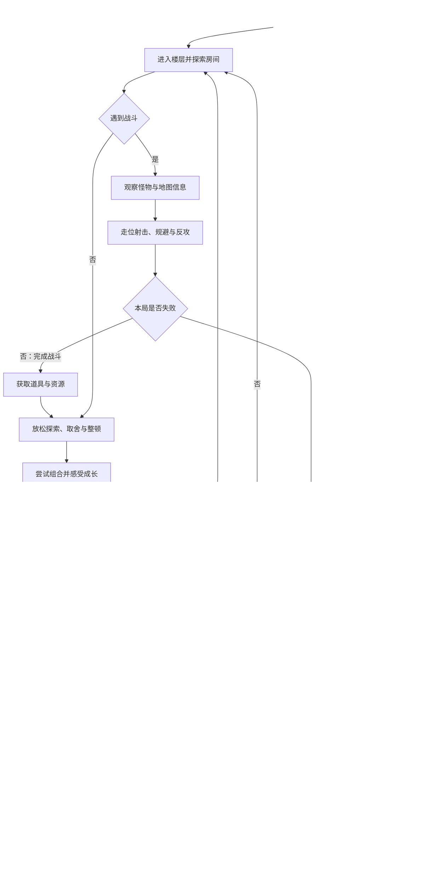
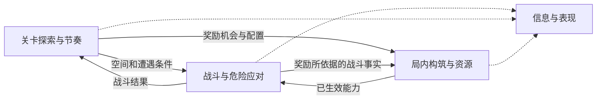

# Turnbased Shoot GDD

## 设计总览

Turnbased Shoot 是低操作门槛的单步制 Roguelite 射击游戏。玩家探索房间，观察敌人预告，通过走位和射击化解危险，再借子弹时间反攻。随机道具与组合带来的成长，与战斗中的危险和反攻同等重要。日常行动可以直观推进，关键局面留出思考时间。暂用太空废土或废弃飞船逃亡的包装，具体叙事后置。

当前主试玩包已有三层单步流程。首轮目标是验证独立单局，采用固定房间与怪物组合，首选六层、30～40 分钟。制作成本过高时，核对成本、缩减范围和验证影响后再决定是否采用三层、15～20 分钟的备选。六项验收标准见「单局与验证」。试玩、构建与代码入口见[项目指引](PROJECTS.md)。

## 定位与体验

Turnbased Shoot 是一款低操作门槛、紧张而爽快的单步制 Roguelite 射击游戏。玩家探索地牢、学习敌人行为、尝试随机构筑，通过走位与子弹时间化解危险并反攻。目标玩家喜欢射击、道具组合和成长，愿意观察与判断，也希望有充分思考时间。日常多数行动可以直观决定，关键局面值得停下来想。

**随机构筑的爽感与射击战斗中的危险、反攻快感同等重要。** 好构筑可以带来阶段性碾压。后续的强敌、不同阵容和布局提供新的应对目标，也给成型构筑发挥的机会。

包装暂用太空废土或废弃飞船逃亡。角色身份、世界观及反复挑战的叙事衔接留待后续设计。

1. 感到随机道具与组合让这一局逐渐变强，对后续奖励抱有期待。
2. 面对危险能通过观察和走位做出应对，并获得主动反攻的快感。
3. 重复挑战后更熟悉敌人，感到自己的判断与角色实力都在进步。
4. 获得强力构筑后，期待发现并战胜足以检验它的敌人与Boss。

以上是已确认目标的归纳，实际达成情况仍需试玩。

> 有点可惜，这套构筑还想继续玩。不过我知道刚才哪里没应对好，下次换个做法，再加上成长，应该能走得更远。

初次遇敌可以因不熟悉而受伤、失败，重复挑战帮助理解危险与应对。具体失败损失和提示方式留给后续设计。

玩家主要通过学习、改善应对和局内构筑推进，局外成长帮助突破。构筑强度是体验描述。局外能力和成长结构待设计。

## 单局与验证

探索房间、观察怪物和地形、走位或射击、获取随机道具与资源、尝试组合，再继续探索或挑战楼层 Boss，直至通关或失败。

战斗理想状态在危险与掌控之间变化。危机一触即发，玩家读懂信息并化解后，可以通过流畅走位或连续击杀迅速扭转局势，随后再遇到值得应对的新危机。怪物与地图应共同改变站位、目标优先级和行动选择。

探索和构筑是放松与整顿阶段。玩家可以慢慢找资源、比较宝物并决定如何利用收获。普通区域鼓励搜全。长期希望每层的探索程度和收益因玩家技术、操作、策略、观察和随机条件而不同。候选方式见[地图探索差异化案例](turnbased-shoot-地图探索差异化案例.md)。

以下包含长期循环；虚线部分属于后续范围，不要求在单局Demo实施。

首轮固定房间和怪物组合，优先把战斗、基础探索、随机构筑与整顿串成独立单局。相邻楼层可高度复用怪物，以布局、阵容和阶段变化提供差异。固定对象是房间和怪物组合，掉落、行动随机及出生点的控制范围仍待确认。完整探索差异、局外成长、多角色和通关后挑战后置。首轮验证通过后，再开发以组合为单位的随机生成。房间数量、实际通关时长与计时口径待评估。

### 六项试玩标准

1. **可理解、可攻克**。玩家能否观察危险信息、规避风险并找到攻克关卡的方式？
2. **危机与掌控交替**。是否出现危险迫近、化解后反攻掌控、随后又面临危机的过程？
3. **稳步变强**。玩家能否感知成长，并在后续战斗中用到新优势？
4. **出彩表现**。是否经常打出令玩家自己惊叹的流畅走位或连续击杀？
5. **节奏分明**。多怪战斗的紧张与探索、取舍、整顿的放松能否形成对比？
6. **怪物和地图配合**。组合是否实际改变玩家的行动与选择，让玩家感到布局与阵容有联系？

试玩记录实际行动、具体满意或不满的时刻、阶段耗时与停止原因。完整闯关、子弹时间触发价值、构筑平衡和经济取舍仍待验证。长期制作平台与迁移范围待定。

### 局内构筑节奏

- **前期**较早让玩家感到道具带来的变化。后续引入多角色时，角色特色主要丰富能力较弱的开局。
- **中期**由随机收获逐渐主导构筑。道具可以与角色特性协同，同一件道具也可能因其他道具加入而变强。
- **后期**允许更不可预测的协同，提供超出预期的强度、趣味或惊喜，让玩家用构筑挑战更强的敌人。
- 大部分收获随机产生，商店等提供部分主动选择。单件道具的基本作用应清楚，组合的实际表现通过游玩发现。带使用成本的额外选择机会留待后续评估。
- 超过一半的组合结果应带来提升。组合应让玩家感到变强、有趣或惊喜，尽量避免单纯变差、严重破坏构筑或明显降低通关机会。有得有失时尽量让得大于失，调整打法后几乎总能得到正向体验。具体衡量方式待试玩设计。

### 跨局与长期目标

- 失败结束当前随机构筑，已获得的局外成长资源和已达成的解锁进度保留。提前主动撤离结算不在设计范围内。
- 局外资源随每局推进积累，普通打怪与清房持续提供，Boss 提供更多，后期难度和收益随进度提高。资源用于局外培养。
- 初期以角色间共享培养为重点，可获得更强开局和改变玩法的阶段性能力。角色独立培养在具体角色设计时考虑。
- 学习敌人、局内构筑和局外成长共同帮助玩家突破。局外培养应让之后的通关更容易，独立单局应先具备足够乐趣。
- 出发前可选角色。角色差异主要影响开局，中后期随机道具组合的影响增大，角色体验可趋近。
- 首次通关后仍可尝试不同角色与组合。后续考虑根据通关进展开放更高难度、更多关卡、内容和不确定性。解锁条件与规模待设计。

单局体验达标后，优先验证最小共享培养循环。玩家带回局外资源，取得一次培养收益，再出发观察是否更容易突破。若首轮仍出现明显重复的基础探索，先处理该缺口。完整探索差异按试玩反馈定优先级。

## 系统框架

### 战斗

拥有行动与伤害结算、怪物计划、危险应对和战斗结果。读取地图限制与玩家当前能力；不决定楼层布局或实际奖励发放。

### 关卡

拥有地图、房间与楼层状态、遭遇配置、进入／离开与推进条件。提供奖励机会和配置；不另算攻击伤害或道具协同。

### 构筑与资源

拥有道具、协同、资源账户、奖励生成／领取与消费，输出已生效能力。依据关卡配置和确认结果处理收获，不自行认定怪物死亡或房间已清空。

### 信息与表现支撑

读取规则状态与结果，呈现危险、动作、伤害、成长和取舍；保持结果与视觉时点可理解。输入请求由对应规则系统验证。具体动画与结算同步接口后续定义。

### 系统依赖

实线表示规则所用的输入与输出，虚线表示信息与表现读取已确定的状态。玩家输入由对应规则处理，信息与表现负责呈现结果。

### 数据流

以清房奖励为例。战斗确认本次遭遇的结算结果，关卡更新房间状态和通行条件，并按房间配置提供奖励机会。构筑与资源处理奖励生成与领取，把已生效能力提供给接下来的行动。

清房只是一条示例。怪物掉落、商店消费及战斗中发生的状态变化，也按各自来源和结算条件进入相应系统。奖励与动作的具体先后顺序留到系统设计。

### 联动检查

| 风险 | 校验方式 |
|---|---|
| 多系统分别认定死亡／清房，结果不一致 | 相同结果是否只确认一次，关卡推进与奖励是否使用同一事实？ |
| 道具变化未真正影响行动 | 玩家是否能在后续战斗感知变强、趣味或组合惊喜？ |
| 提示与实际结算冲突 | 玩家能否依据当前信息形成有效应对，理解受伤或成功的原因？ |
| 表现等待或输入积压破坏丝滑感 | 是否能连贯执行意图，动作与命中反馈是否对应实际结果？ |
| 楼层复用变成重复清扫 | 相同怪物与不同地图／阵容是否仍改变选择，后段是否保持期待？ |
| 构筑取舍被误当成压力 | 非战斗是否允许放松思考，紧张与舒缓是否分明？ |

## 行动、危险与子弹时间

正式版用 WASD 移动，方向键执行射击指令，E 使用炸弹，M 开关地图，Esc 关闭地图，R 重开。基础移动每次一格。武器效果可把一次射击指令转化为多发或蓄力进度。有效普通行动推进敌方行动及自主计时。玩家射击先结算，移动则先改变落点，再结算怪物行动。动作未到位时的额外输入丢弃，动作到位后可继续操作，余效独立播放。

黄格与红格都表示已锁定的攻击，多只怪物可以同时预告。射击直接命中可以打断黄招，怪物随后恢复一回合。一次射击可打断多个目标。红招可通过有效闪避触发子弹时间。自定义场可切换到原红格闪避版。

怪物在行动之间生成已保存的计划。[单步调度](../src/combat/single-step-mode.js) 汇总可执行攻击范围绘制危险格，重复格去重。提示基于当前状态下解析的已保存计划。实际行动前的击杀、位移或状态变化可能改变结果，试玩需检查玩家是否理解差异。

玩家移动避开原位置会命中的红招，且该步实际未受伤时，获得两次额外行动。触发步正常结算。额外行动期间，怪物和自主计时暂停，玩家造成的伤害与破坏仍有效。实际受伤会中断奖励，奖励结束后由下一次普通行动恢复推进。受击保护按有效行动递减，视觉闪烁和受击帧用于标记保护与命中。

清房结束子弹时间。成功闪避涉及的多只怪物都会标记。动态尖刺按伸出两步、缩回两步、准备一步循环，玩家站在即将伸出的尖刺格时才显示红格。

验证关注危险能否读懂、成功规避能否形成反攻机会，以及触发频率是否仍有分量。流畅感结合移动、命中、连杀和输入释放观察。

## 怪物、地图与关卡推进

### 怪物行为

普通怪物优先检查攻击，再检查追击，最后执行待机或游走。攻击目标按计划锁定。步行追击选最短可达路线，同长优先较长轴，等轴可随机，遇障碍可绕路。跳跃射手按合法落点和射线判断。

| 阵容 | 主要行为 |
|---|---|
| 固定射手、移动射手 | 固定射手只用黄招。移动射手黄招射三格，红招沿面向的整行或整列射至障碍或墙 |
| 大、小史莱姆 | 近距离短冲为黄招，大史莱姆死亡后分裂，清房判定考虑新生怪 |
| 近战者、冲锋者 | 原有攻击为黄招。近战者红招覆盖前方 1+3 格，冲锋者红招沿选定方向冲至障碍或墙 |
| 自爆者 | 黄招为一格近战，红招为九格自爆，可破坏障碍并伤及其他怪物 |
| X 射手、十字射手 | 优先跳到能射到玩家的空格，追击跳跃成功后有 50% 概率准备红招。无射击点时跳到随机合法空格，之后继续跳跃。分别发射对角或正交射线 |
| 楼层 Boss | 保留跳跃、召唤等行为，移动碰撞的伤害范围显示红格 |

双招都能命中时，红招概率为 35%，其余为黄招。场上至少有一只怪物追击，追击者死亡且无人继续追击时补选。受击退的怪物取消本步原定游走或追击。子弹时间内位移会更新已锁定的攻击范围，攻击内容和方向沿用原计划。

敌人、普通小队和攻击配置见[单步敌人表](../Configs/single-step-enemies.json)。Boss 行为见[怪物配置](../Configs/monster-db.json)及对应战斗实现。部分攻击对其他怪物的伤害由配置控制。

后续方向是让 Boss 支持通用追击及多种攻击行动。

### 房间与探索

[楼层配置](../Configs/floor-data.json)提供房间、门、布局和楼层连接，[模板池](../Configs/pool.json)提供地形布局。普通房间、商店、宝物房和 Boss 房承担不同功能。岩石、可破坏障碍、深坑及尖刺改变移动、射线和战斗选择。战斗中按房门规则锁门，清房后恢复通行。进入上锁房间时消耗钥匙。清空与 Boss 房相连的前置房间后，门开放即可进入 Boss 房，无额外入场条件。Boss 战结果驱动通往下一层的梯子，末层结束后通关。

**待决定**　每层是否常备商店和宝物房，以及各层的战斗／整顿节奏、房间任务和内容预算。首轮把地形、怪物和站位作为一组配置。地图探索初步采用可折返的房间网络。密室、推箱和回访设施等候选见[地图探索案例](turnbased-shoot-地图探索差异化案例.md)。

长期目标是让怪物和地形共同改变站位、射击顺序和目标优先级。普通区域希望大多搜全。额外发现、进入条件和收益差异的具体机制后续选择。非战斗探索、整理与选购承担放松节奏。

## 道具与构筑

爆炸子弹在首次命中或飞行结束时引爆，覆盖中心与周围八格。敌人额外受到该发直击伤害的 1.5 倍，玩家受到 1 点伤害，沿用受伤保护。溅射子弹飞行结束也触发，电弧单跳最远为射程的 50%。岩石可由炸弹或爆炸子弹破坏。寄生爆弹按层显示黑色液体，宿主死亡会按当前层数引爆。弹药回收每次攻击击杀至少一只怪物返还一次射击，额外射击也能返还。

### 正式目录

正式版和自定义场共用[道具配置](../Configs/item-db.json)中的 singleStepItems，共 60 件。下表列出代表道具。

| 类别 | 代表道具 |
|---|---|
| 属性强化 | 攻击力+、射程+、生命+ |
| 发射数量与方向 | 双管、三管、三叉管 |
| 发射方式 | 蓄力枪管（连击／合体）、能量衰减枪管、能量增幅枪管 |
| 枪体 | 霰弹枪、能量光速枪 |
| 子弹伤害模式 | 穿透、爆炸、溅射、电弧、追踪、空间折叠 |
| 弹药 | 毒性子弹 |

武器按子类装配。拾取同子类效果会覆盖原有装配，跨子类与属性道具可以组合。例如穿透与爆炸同属伤害模式，拾取后会发生替换。穿透与毒性分属两个子类，可以同时生效。组合细节由[武器结算](../src/combat/weapon-upgrades.js)决定。剑仍待单独设计。

当前正式版踩格自动拾取或尝试购买。道具抽选过滤当前无法拾取的条目，抽中品质没有可用项时回退至可用目录。已预抽的怪物道具在生成时检查可用性。单件作用清楚、允许玩家判断是否拿取是后续设计目标。

### 代表性被动与状态

- 怪物默认互不伤害，指定攻击可按配置例外。游走和追击不显示蓝色落点。
- 充能护盾占一个心位，拾取即满，挡伤后主动移动 20 格充满。背甲在角色背面显示，换房补充。
- 补给无人机每清三间战斗房补充一份当前持有量最低的资源。换房清理地面液体，换层清除本层攻击加成。
- 地面毒、粘液、硫酸分别为绿、白、黄。粘液延迟原定移动一个正常回合，玩家进入攻击范围也不打断这次移动。

### 构筑验证

前期观察首批道具是否产生可感知的变化，中期比较协同是否改变行动，后期检查组合惊喜及强敌检验。组合收益应能体现在后续战斗的站位、命中或击杀方式上。组合的正向体验边界见「局内构筑节奏」。

自定义战斗场可摆放同类覆盖和跨类组合对照，木桩统计命中次数、总伤害及末次伤害。木桩适合定位效果差异，实际价值结合遮挡、敌人组合和走位判断。现有试玩重点包括蓄力节奏、霰弹与数量强化的关系，以及多发、穿透、附加状态如何改变实战。

## 局内资源、掉落与商店

| 资源或机会 | 当前用途 |
|---|---|
| 红心、蓝心 | 恢复生命或提供额外伤害缓冲。初始生命上限为 10，横向血条显示当前生命与上限，蓝心单独显示 |
| 金币 | 在商店购买道具和资源 |
| 钥匙 | 开启上锁房间及需要钥匙的宝箱 |
| 炸弹 | 放置、推动与爆炸，用于战斗或破坏可作用的环境 |
| 宝箱、宝物房、Boss 奖励 | 提供随机道具或资源，内容由对应掉落与房间配置决定 |

木箱和普通怪物提高金币及红心掉率。木箱任意资源掉率为 37%，其中金币 13%、红心 18%。其他资源沿用原权重，岩石资源掉率为 3.5%，普通随机道具仍为低掉率，宝物房与 Boss 保留必掉规则。

怪物、清房和可破坏地形按各自配置产生奖励。资源类型与权重见[资源配置](../Configs/resource-db.json)，单步道具品质权重见道具表的 singleStepItemDropTables。商店库存与价格由房间配置、楼层修正和商店规则共同决定。炸弹引信由资源配置提供，普通有效行动推动倒计时。重新进入房间时，定时炸弹恢复到完整倒计时。

局外成长资源随普通打怪、清房与 Boss 战累积，后期奖励随推进增加，死亡后保留并用于培养。这是长期设计，局外培养和结算留待独立单局验证之后。

## 表现与设计职责

危险格、头顶感叹号、移动提示、命中与受击反馈、冻结和解除效果共同帮助玩家理解局势。地图弹窗、道具和资源反馈服务探索与整顿。

表现根据规则结果播放，命中、受击、死亡、冻结与解除的视觉时点应对应实际动作。真实运行与审核入口见[项目指引](PROJECTS.md#工程入口与项目约定)。

## 试玩、维护与后续范围

- **场景验证**关注攻击预告、闪避、反攻、阵容与地形配合，以及同类覆盖和跨类组合。自定义场用于控制变量，完整闯关用于观察整局节奏。
- **整局验证**按照「单局与验证」的六项标准，记录玩家行为、危机与反攻时刻、成长感、动作表现、战斗与探索节奏以及怪物和地图的配合。六层成本、实际时长和组合平衡仍待验证。
- **设计待定**包括首轮种子与掉落的控制方式、房间数、完整掉落规则、探索设施，以及具体角色、培养和解锁内容。主动、跟班等新成长系统等待试玩确认需求。
- 构建、回归检查和试玩入口见[项目指引](PROJECTS.md)。
- 决策演变和旧方案见[项目记忆](turnbased-shoot-memory.md)。
