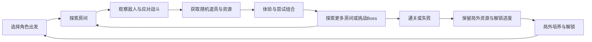
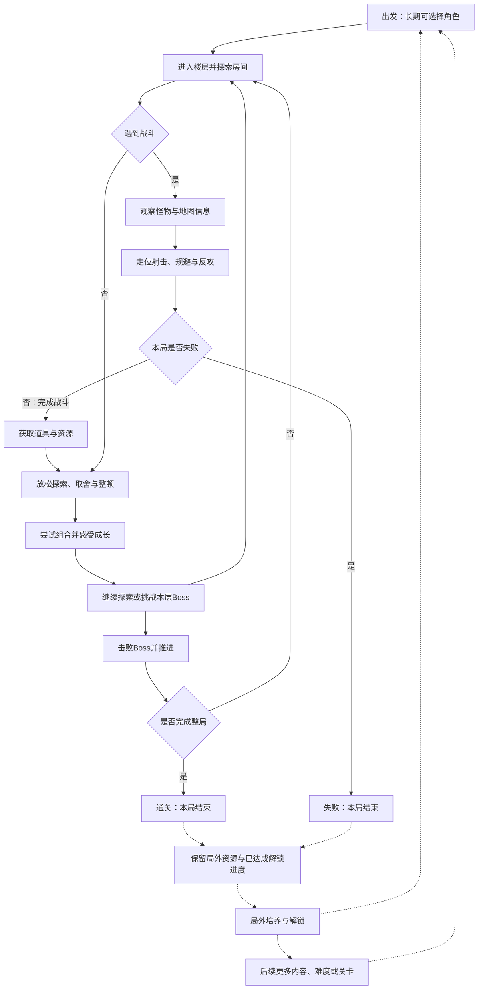
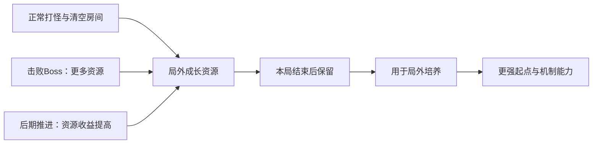

# 顶层设计：Turnbased Shoot

> 状态：当前阶段已确认，进入架构设计。
> 最后定稿: 2026-11-08（后续可按讨论与验证调整）
> 上游：`../00_concept/design.md`　下游：`../02_architecture/design.md`

## 顶层定位

玩家以一局探索与战斗为基本单位：局外以成长、解锁和选择角色为主；局内探索房间、应对敌人、获取以随机为主的道具和资源，尝试组合并挑战Boss，直到通关或失败。已获得的局外成长资源及已达成的解锁进度保留，支持培养后再次出发。

长期既期待不同角色、构筑和内容，也期待成长让已有通关流程更容易；后续考虑通过解锁更多关卡、难度、内容与不确定性，提供新的挑战。

## 规模锚点

规模用于组织验证，实际成本和时长仍需评估。

| 项 | 定义 |
|---|---|
| 循环单位 | 一局探索与战斗，通关或失败后进入局外培养并再次出发 |
| 局外段 | 以成长、解锁为主；出发前选角色，其他配置后置；时长待定 |
| 首次单局验证首选 | 6层地牢，目标30～40分钟；需进行内容成本评估与实际计时验证 |
| 操作复杂度 | 低操作门槛，单步推进提供思考时间；出彩走位不以即时反应门槛为前提 |
| 思考复杂度 | 日常多数行动凭直观判断，关键局面认真思考；非战斗可慢慢比较与整顿 |
| 验证顺序 | 先验证独立单局，再验证局外成长与跨局循环，之后扩展长期挑战 |
| 长期期待 | 不同角色与组合、成长后更易通关、后续内容与更高挑战；三者未设严格优先级 |

成本过高时的备选为3层地牢、15～20分钟。需要缩减时先向用户同步成本依据、范围与验证影响，再确认调整。每层房间数、失败局时长、局外阶段与计时口径另行确定。

## 核心循环图

依据已确认内容整理，包含长期局外循环；当前Demo只验证其中的单局部分：

## 完整循环图

以下包含长期循环；虚线部分属于后续范围，不要求在单局Demo实施。

## 资源流图

以下仅整理已确认的局外成长资源流；局内消费资源的流向仍待补充。

## 单局流程与构筑节奏

| 阶段 | 玩家行为 | 设计目的 |
|---|---|---|
| 局外准备 | 用积累资源培养、解锁，选择角色出发 | 更强起点与不同开局体验，初步以共享培养为主 |
| 局内前期 | 以角色特色应对战斗，较早体验随机道具的明显效果 | 在基础能力较弱时仍有趣味，并开始期待本局发展 |
| 局内中期 | 持续探索、战斗和获取道具，尝试组合与协同 | 随机收获逐渐主导玩法差异，形成构筑体验 |
| 局内后期 | 进一步组合构筑，挑战更强敌人与Boss | 放大组合的不确定性，创造超出预期、整体偏正面的体验，并检验构筑 |
| 本局结束 | 通关或失败，保留局外成长资源与已达成解锁进度 | 结束当前构筑，支持培养后再次尝试 |

后期组合追求超出预期且整体正向的体验。此前“8分好、2分不好”不是要求制造明显负面结果；具体边界见下节。具体发放时点、层数与掉落数值未定，不保证每局获得指定组合或强力成型。

## 组合的正向体验边界

- 超过一半的组合结果应带来提升；组合至少应让玩家感到变强、有趣或出乎意料。
- 尽量避免单纯变差、非常明显的负面组合，避免严重破坏当前构筑或明显降低继续通关机会。
- 可以有一部分有得有失的组合，但尽量保证得大于失。允许玩家调整打法，调整后的结果应几乎一定正向。

具体实现与验证口径尚待设计。此为目标体验，不等于已验证现有道具能满足。

## 局外段：成长、解锁与选角色

局外以成长、解锁为主。出发前可以选择角色，各角色应有不同的构筑风格、模式，并带来不同的实际游玩体验。

其他出发前配置是否需要后续再议。角色数量、具体能力与道具池规则尚未确定；角色系统当前属于设计目标。

## 角色与局内随机构筑

角色差异主要在开局较大，为能力较弱、可能枯燥或较有挑战的阶段提供一定趣味。中后期角色差异的相对影响逐渐减小，随机道具成为主要影响，各角色的体验可以趋于接近。

道具可以围绕角色特性形成协同：同一道具在某些角色上表现一般，在另一些角色上很强；道具之间的组合也能让原本一般的效果变强。角色不锁定整局的专属构筑体系，也不要求全程保持同等显著的差异。

## 随机收获与主动选择

局内构筑以随机收获为主，主动选择为辅。大部分道具来自随机收获，商店等机会允许玩家部分影响构筑方向。鼓励玩家尝试组合，通过实际游玩体验道具效果。

后续候选：可增加带一定使用成本的主动选择机会。具体机制、成本和实施范围尚未确定。

## 道具信息与尝试发现

单件道具的基本作用应清楚，玩家带着预期尝试；组合后的表现、实际强度和手感通过实战发现。具体说明形式与界面留待系统设计。

## 每层探索的差异化目标

普通区域希望玩家大多搜全。同时，每层探索应体现一部分差异化：不同玩家的技术、操作、策略、理解与推理水平等差异，以及一定随机性，使探索结果有所不同；探索程度与收益程度都可以各不相同。

这是整体探索预期，不限于隐藏内容。具体采用哪些差异来源、机制及差异幅度尚待设计，也不要求所有来源同时采用。

参考案例见项目Documents/turnbased-shoot-地图探索差异化案例.md，其中案例与倾向尚未作为机制采纳。

## 战斗与探索／构筑的压力节奏

战斗承担集中危机、规避与反攻的紧张体验。探索、构筑阶段用于缓解和放松，玩家可以慢慢考虑构筑、整顿并寻找有利资源，不需要强压力。

宝物与资源取舍可以保留；非战斗状态下的难以抉择不计作压力。不能以选择难度本身替代用户所说的危险与紧张。

## 局内段：探索、构筑与战斗推进

- 难度通过怪物、地图及其组合和后续更强挑战体现，信息应支持玩家理解危险并找到应对方式。
- 随机收获为主，商店等提供部分主动选择；构筑从前期可感知变化，发展到中后期协同与意外体验。
- 战斗承担危机与反攻，非战斗探索和构筑用于放松、取舍与整顿。
- 一局主要以通关或失败结束，不设置提前主动撤离；长期设计中，死亡仍带回已获得的局外成长资源。暂停存档、主动放弃等便利功能另议。
- Demo先验证独立单局，首选6层、30～40分钟；成本过高时先同步，再考虑3层、15～20分钟。

## 局外成长资源的来源与用途

- 正常打怪、清空房间等持续提供积累，不依赖少数关键节点。
- Boss提供更多局外成长资源。
- 随整局推进，后期难度、收益和局外成长资源获取量提高。
- 已获得的局外成长资源死亡后仍可带回，用于局外培养。

具体资源种类、培养结构、收益数值与单位时间收益率尚待设计和验证。特殊探索是否额外提供局外资源未单独确定。

## 局外培养的共享与独立

共享与独立可以结合，初步重点为角色间共享的培养成果。角色独立培养留待实际进行角色设计时再考虑，当前不确定其形式与范围。

## 失败与回收

| 内容 | 失败后的结果 |
|---|---|
| 当前局内随机道具构筑 | 结束，下一局重新形成组合 |
| 已获得的局外成长资源 | 保留 |
| 已达成的解锁进度 | 保留 |

目标是既保留对当前构筑的惋惜，也留下学习所得和长期积累，支持再次尝试。具体资源划分、结算方式与通关奖励尚未确定。

## 楼层体验差异与Demo复用

楼层间应有可感知的战斗或探索变化，可通过怪物组合、地形关系、环境特点或Boss等形成不同应对。

前期体验Demo允许变化较少，例如每两层使用重合度较高的怪物，以节约验证成本；不要求每层一套全新怪物或独立美术。具体怪物安排、变化密度与Boss复用规则待后续设计。

## 最小验证范围与后续顺序

第一阶段只验证独立单局的游戏体验：战斗、探索、随机构筑，以及单局内前中后段的体验变化。单局本身必须好玩、有趣，才能支持后续多局循环；不能依赖局外成长或奖励弥补单局体验不足。

| 范围 | 当前定位 | 原因 |
|---|---|---|
| 单局战斗、基础探索与随机构筑 | 第一阶段核心验证 | 验证一局循环本身好玩，包含局内前中后段体验变化 |
| 玩家之间的探索程度与收益差异 | Demo非必需，后续设计 | 用户确认Demo可无此差异，先验证单局循环 |
| 局外资源积累、共享培养与跨局解锁 | 后置验证 | 先证明独立单局成立，再检验长期循环的作用 |
| 多角色扩展与角色独立培养 | 后续角色设计时展开 | 先检验基础单局，独立培养已明确后置 |
| 通关后新增难度、关卡、内容与不确定性 | 长期扩展 | 依赖基础单局与后续循环验证 |

Demo不要求具备探索差异；首轮采用固定房间与怪物组合，验证通过后再开发成对随机生成。种子与掉落的控制方式待定。上述后置不撤销已有长期目标。首次验证优先6层、30～40分钟；若内容制作成本过高，先同步用户，再考虑3层、15～20分钟备选。具体内容清单、房间数与实际时长待评估和验证。

## 长期结构

首次通关后同时保留以下目标：

1. 继续尝试不同角色、随机构筑和未见内容。
2. 通过局外成长，让之后的通关过程更容易。
3. 进一步挑战更强或更复杂的敌人与关卡，检验构筑及对敌人的理解。

后续考虑在通关达到一定程度后增加难度或关卡，解锁更多内容和不确定性。已有流程逐渐变轻松与后续更高挑战共同提供长期期待。

具体解锁条件、难度结构与扩展内容数量尚未确定；最小验证范围见上节。角色独立培养仍留到实际角色设计时考虑。

## 系统范围（已确认的设计职责）

| 设计范围 | 顶层目的 | 当前边界 |
|---|---|---|
| 战斗与危险应对 | 让玩家能读懂危险、规避风险、化解危机并反攻，产生出彩走位和连续击杀 | 确定行动、危险应对与战斗反馈的责任；具体怪物、攻击数值与表现细节后续展开 |
| 关卡探索与节奏 | 串联房间、楼层与Boss，使怪物和地图共同影响应对，并交替提供紧张战斗与放松探索 | 保留6层首选验证规模及Demo复用边界；探索差异非Demo必需，具体地图与阵容后续设计 |
| 局内道具、构筑与资源取舍 | 以随机收获为主，让玩家持续变强、尝试组合，在放松阶段做取舍与整顿 | 包括道具效果与协同、局内奖励和消费；具体内容表、经济数值与界面后续展开 |

信息呈现、动作表现与反馈贯穿三组，支撑可观察、可理解的危险、可感知的构筑变化和丝滑行动。以上是设计责任归纳，不规定代码模块。

长期范围保留局外培养与跨局解锁、角色扩展、通关后挑战扩展；当前单局Demo后置这些内容。具体依赖、接口及优先级留到架构层。

## 当前不做与后置边界

| 边界 | 原因 |
|---|---|
| Demo不依靠局外培养弥补单局体验 | 先证明独立单局本身好玩，再验证跨局循环 |
| 不设置提前主动撤离结算 | 用户明确不需要；长期成长资源死亡也可带回 |
| 探索与构筑不引入强压力作为主要体验 | 用户要求这一阶段缓解、放松并慢慢思考 |
| 尽量避免明显负面组合、构筑报废与显著降低通关机会 | 构筑追求变强、有趣或惊喜，取舍尽量得大于失 |
| Demo不要求实现完整探索差异与每层全新怪物阵容 | 先验证单局循环，可降低变化密度控制成本 |
| 暂不展开局外培养、多角色及通关后挑战扩展 | 保留长期目标，当前验证范围已明确后置 |

## 验证标准

以下六项为用户明确给出的主要标准；通过实际行为和具体体验反馈判断，尚未完成验证。

| 验证点 | 目标体验与自检问题 |
|---|---|
| 战斗逻辑可理解、可应对 | 玩家能否通过观察信息规避风险，并找到攻克关卡的方式？ |
| 危机与掌控动态交替 | 是否接近“受伤／死亡与无伤／碾压的交界”，反复经历危险一触即发、化解后扭转形势并获得掌控、随后再面对危机？ |
| 稳步变强 | 玩家能否持续感到自身在逐渐变强？ |
| 出彩的行动表现 | 玩家是否经常打出令自己惊叹的丝滑走位或连续击杀？ |
| 战斗与探索／构筑节奏分明 | 是否有紧张连续面对多怪的阶段，也有能够放松、慢慢思考构筑、整顿及探索的阶段？非战斗取舍即使难选，也不据此计为压力。 |
| 怪物与地图具有结构性配合 | 怪物和地图的组合是否实际影响走位、攻击和选择倾向，让玩家感到二者配合的设计感？ |

补充观察：随机收获是否产生可感知的变强、趣味或惊喜；构筑变化是否能在后续战斗发挥；前中后段是否持续有期待，避免主要靠重复清房拖长流程。

判断结合玩家实际行动、具体满意或不满的时刻及停止原因；通关、领取奖励或愿意重玩不能单独证明好玩。危机感不等于必须频繁扣血；丝滑走位不据此引入即时反应门槛。具体样本、量化指标与通过阈值待后续验证设计确定。

## 当前结论与后续交接

顶层设计以独立单局体验验证为当前重点：通过战斗、关卡探索与节奏、局内道具构筑及资源取舍三组职责，支撑危险与掌控交替、稳步变强、出彩行动和紧张／放松交替的循环。信息呈现、动作表现与反馈贯穿其中。

下一层架构需围绕上述职责明确系统依赖、数据流和验证闭环。本文档已由用户整体确认；后续设计不等于获准实施代码。

待后续设计与评估：每层房间数、具体怪物／地图／道具组合、资源和奖励数值、首轮的种子与掉落控制方式、试玩样本与量化阈值，以及首选规模的成本和实际时长。完整探索差异、局外成长、角色扩展和通关后挑战按既定边界后置。
