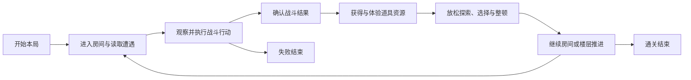
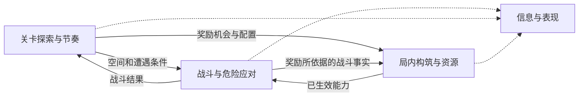

# 系统架构：Turnbased Shoot

> 状态：当前阶段架构基线。三组系统责任已确认，后置验证顺序按用户采纳的建议推进。
> 上游：../01_top_design/design.md；下游：../03_systems/。

## 架构定位

将已确认的三组顶层职责转为系统边界、输入输出与依赖，支撑独立单局验证。此为设计架构，不等于当前代码结构，也不授权代码重构。单系统内部规则、具体内容和数值后续展开。

## 一句话架构

关卡提供空间与遭遇，战斗结算玩家和敌人的行动，构筑与资源将收获转为能力变化；三者反复配合，推进至通关或失败，信息与表现支撑整个过程。

## 总体闭环

## P0系统清单

P0指Demo单局循环成立所需的设计职责，不表示全部需要从零新建。

| 系统 | 目的 | 输入 | 输出 | P0原因 |
|---|---|---|---|---|
| 战斗与危险应对 | 可理解、可规避的危机与反攻 | 玩家行动、地图与单位状态、构筑能力 | 行动和伤害结果、怪物意图、战斗结束事实 | 缺少它，危险应对与掌控交替无法验证 |
| 关卡探索与节奏 | 空间与遭遇共同影响行为，串联楼层与舒缓阶段 | 地图和遭遇配置、战斗结果、探索进度 | 可用空间与遭遇、奖励机会与配置、进出及推进状态 | 缺少它，只能验证孤立战斗，不能验证整局节奏 |
| 局内道具、构筑与资源取舍 | 随机收获、能力变化与非战斗取舍 | 奖励机会及配置、领取／消费行为、现有道具资源 | 道具与资源变化、协同结果、已生效能力 | 缺少它，另一半核心体验及稳步变强无法验证 |

信息呈现、动作与反馈为三组共同的P0支撑：危险提示、动作流畅度、命中结果、构筑变化与选择说明均需可理解。此处不单独增加第四组玩法系统。

## 系统职责与边界

### 战斗

拥有行动与伤害结算、怪物计划、危险应对和战斗结果。读取地图限制与玩家当前能力；不决定楼层布局或实际奖励发放。

### 关卡

拥有地图、房间与楼层状态、遭遇配置、进入／离开与推进条件。提供奖励机会和配置；不另算攻击伤害或道具协同。

### 构筑与资源

拥有道具、协同、资源账户、奖励生成／领取与消费，输出已生效能力。依据关卡配置和确认结果处理收获，不自行认定怪物死亡或房间已清空。

### 信息与表现支撑

读取规则状态与结果，呈现危险、动作、伤害、成长和取舍；保持结果与视觉时点可理解。输入请求由对应规则系统验证。具体动画与结算同步接口后续定义。

## 系统依赖

实线表示规则所用的输入与输出，虚线表示信息与表现读取已确定的状态。玩家输入由对应规则处理，信息与表现负责呈现结果。

## 数据流

以清房奖励为例。战斗确认本次遭遇的结算结果，关卡更新房间状态和通行条件，并按房间配置提供奖励机会。构筑与资源处理奖励生成与领取，把已生效能力提供给接下来的行动。

清房只是一条示例。怪物掉落、商店消费及战斗中发生的状态变化，也按各自来源和结算条件进入相应系统。奖励与动作的具体先后顺序留到系统设计。

## L4目录映射

| 计划目录 | 对应范围 |
|---|---|
| 03_systems/S01_战斗与危险应对 | 行动结算、怪物意图、规避与反攻，以及对应提示与反馈 |
| 03_systems/S02_关卡探索与节奏 | 地图、遭遇、进出与推进，以及探索时的信息 |
| 03_systems/S03_局内构筑与资源 | 道具、协同、奖励与消费，以及成长与取舍的反馈 |

目录名称为后续整理所用，具体系统设计从L4开始。

## 后置边界

| 内容 | 当前定位与原因 |
|---|---|
| 局外培养与跨局循环 | 单局体验成立后验证，避免依赖长期奖励弥补局内体验 |
| 多角色、角色独立培养 | 具体角色设计时展开，不扩张当前单局Demo范围 |
| 探索差异机制 | 长期目标保留，Demo非必需，具体来源尚未选择 |
| 通关后新增难度、关卡及内容 | 基础单局及后续循环成立后扩展 |

单局试玩达到体验标准后，优先验证最小共享培养循环。玩家带回本局成长资源，获得一次培养收益，再出发感受它是否帮助突破。若单局试玩显示基础探索仍明显重复，先修正该缺口，再扩展跨局循环。完整探索差异按试玩反馈定优先级，多角色、角色独立培养及通关后扩展继续后置。

## MVP最小闭环

1. 玩家进入具有地图和遭遇配置的房间，获得足够理解当前局势的信息。
2. 通过走位、射击与反攻应对怪物，地图与怪物共同影响选择。
3. 规则确认战斗结果与房间状态，触发对应奖励机会。
4. 玩家获得随机为主的道具资源，感知能力变化，并在非战斗中放松、取舍和整顿。
5. 带着变化后的能力继续探索和战斗，逐步经历单局前中后段。
6. 推进至通关或失败，以顶层六项标准评价单局体验。

优先6层、30～40分钟；成本过高需先同步，再考虑3层、15～20分钟。闭环未成立前，不以增加局外培养、多角色和更长内容作为替代验证。

## 风险与校验

| 风险 | 校验方式 |
|---|---|
| 多系统分别认定死亡／清房，结果不一致 | 相同结果是否只确认一次，关卡推进与奖励是否使用同一事实？ |
| 道具变化未真正影响行动 | 玩家是否能在后续战斗感知变强、趣味或组合惊喜？ |
| 提示与实际结算冲突 | 玩家能否依据当前信息形成有效应对，理解受伤或成功的原因？ |
| 表现等待或输入积压破坏丝滑感 | 是否能连贯执行意图，动作与命中反馈是否对应实际结果？ |
| 楼层复用变成重复清扫 | 相同怪物与不同地图／阵容是否仍改变选择，后段是否保持期待？ |
| 构筑取舍被误当成压力 | 非战斗是否允许放松思考，紧张与舒缓是否分明？ |

## 系统设计交接

从战斗与危险应对开始，将现行规则整理成单局Demo的验证基线。后续依次展开关卡探索与节奏、局内构筑与资源。规则时点、跨系统接口与具体内容在各系统设计中核对。
