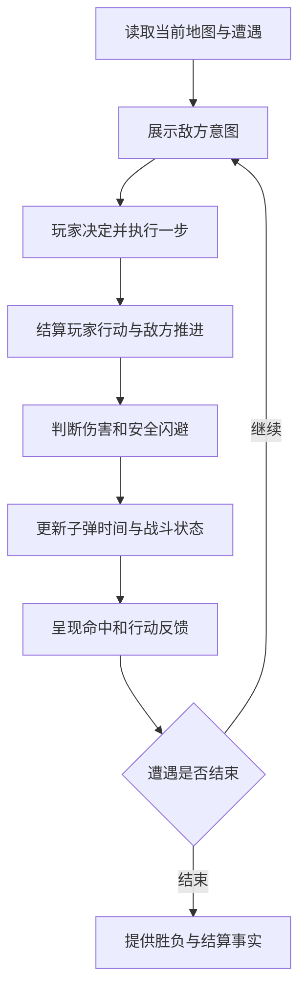

# S01 战斗与危险应对

> 当前阶段设计基线。黄格打断与红格闪避已进入正式试玩，多怪预告和整局节奏仍待持续观察。
> 上游：[系统架构](../../02_architecture/design.md)

## 设计目的

- 玩家能依据危险预告与地图信息找到攻克遭遇的办法。
- 战斗反复经历危险迫近、主动规避、反攻掌控和新的危机。
- 玩家能通过走位、射击和构筑效果打出出彩行动或连续击杀。

## 系统范围

战斗负责行动合法性、单位状态、怪物意图、伤害、规避与反攻，以及遭遇结束的事实。关卡提供空间、障碍和阵容，接收战斗结果以推进房间。构筑与资源提供已生效的能力，并依据相应事实处理掉落或消费。

## 核心循环

## 关键操作与现行基线

| 操作或规则 | 玩家行为与体验 | 当前基线 |
|---|---|---|
| 观察与走位 | 读出攻击范围、选择落脚格，利用地形避险或改变射击条件 | 基础移动一格，怪物执行已保存的意图，结算时根据当前局面解析 |
| 射击 | 选择方向和击杀顺序，观察构筑如何影响实战 | 玩家射击先于本步敌方推进，一次射击指令按当前武器效果处理 |
| 打断黄招 | 优先射击准备攻击的怪物 | 直接射击命中可打断黄招，怪物进入一回合恢复。一次射击可打断多个目标 |
| 子弹时间 | 规避后抓住机会重新站位或连续反击 | 从原本会被红招命中的位置移开且整步未实际受伤，触发步照常结算，随后获得两次额外行动 |
| 放置炸弹 | 投入局内资源处理战斗或地形 | 复用现行炸弹与倒计时规则，消耗由构筑与资源记账 |

子弹时间内暂停敌方及场景自主推进。玩家行动造成的效果仍然生效，实际受伤会提前结束奖励。奖励结束后的下一次普通行动恢复推进。受击保护依现行规则按有效行动递减。动作到位后可继续操作，非阻塞余效独立播放。

## 状态与接口

| 状态或结果 | 所有者与用途 |
|---|---|
| 单位位置、生命及战斗状态 | 战斗用于行动和伤害结算。地形限制与变更通过关卡状态协调 |
| 已保存敌方意图、当前威胁格 | 战斗提供给结算与表现，使玩家能理解危险 |
| 子弹时间、受击保护与动作结果 | 战斗更新。表现据此显示冻结、解除、受击及命中反馈 |
| 当前房间和遭遇 | 关卡提供给战斗。战斗交回击杀、遭遇结束和玩家死亡等事实 |
| 已生效构筑能力 | 构筑与资源提供。战斗按这些能力结算行动并提供结果 |

## 信息呈现

玩家决策前可看到已锁定的黄格和红格，以及相关怪物的感叹号。多只怪物可以同时显示预告。攻击叠加时应能判断哪些落点危险，关键命中和死亡在对应动作时点显示。击杀、位移或状态变化改变了已预告结果时，试玩观察玩家是否能根据画面解释原因。构筑的成长反馈与战斗结果相互对应。

## P0最小闭环与校验

1. 固定一个房间，玩家在输入前能识别直接威胁，找到有效应对。
2. 正常结算玩家行动和敌方意图，对照危险提示、实际命中与反馈。
3. 验证安全闪避、子弹时间内的反击和恢复推进能否连成一个可理解的过程。
4. 用相同阵容改变布局，对照站位、目标优先级与行动顺序是否变化。
5. 让玩家从相同遭遇中体验基础装备与一种有效组合，检查构筑是否产生可感知的实战优势。
6. 遭遇结束后，关卡与构筑系统使用同一结果衔接通行和奖励。

先用少量对照场景定位战斗问题，再在完整单局检验触发频率、成长和节奏。首次整局采用固定的房间与怪物组合，具体对照条件按验证目标确定。扩展触发方式、更多反攻机制和额外操作层等试玩指出具体缺口后再评估。

## 验证标准

| 目标 | 验证问题 |
|---|---|
| 危险可读、可以攻克 | 玩家能否在行动前说出主要风险，行动后解释为何安全或受伤？ |
| 危机转为反攻 | 额外行动是否经常被用于主动输出或换取更好的站位？玩家是否感到这次规避有价值？ |
| 动作流畅 | 玩家能否连续执行自己的判断，走位和击杀反馈是否清楚对应结果？ |
| 地图与阵容配合 | 改变地形后，玩家是否主动改变站位、目标或行动顺序？ |
| 构筑有用 | 在同一遭遇中，玩家能否说出新能力让自己能做什么，并实际利用它？ |
