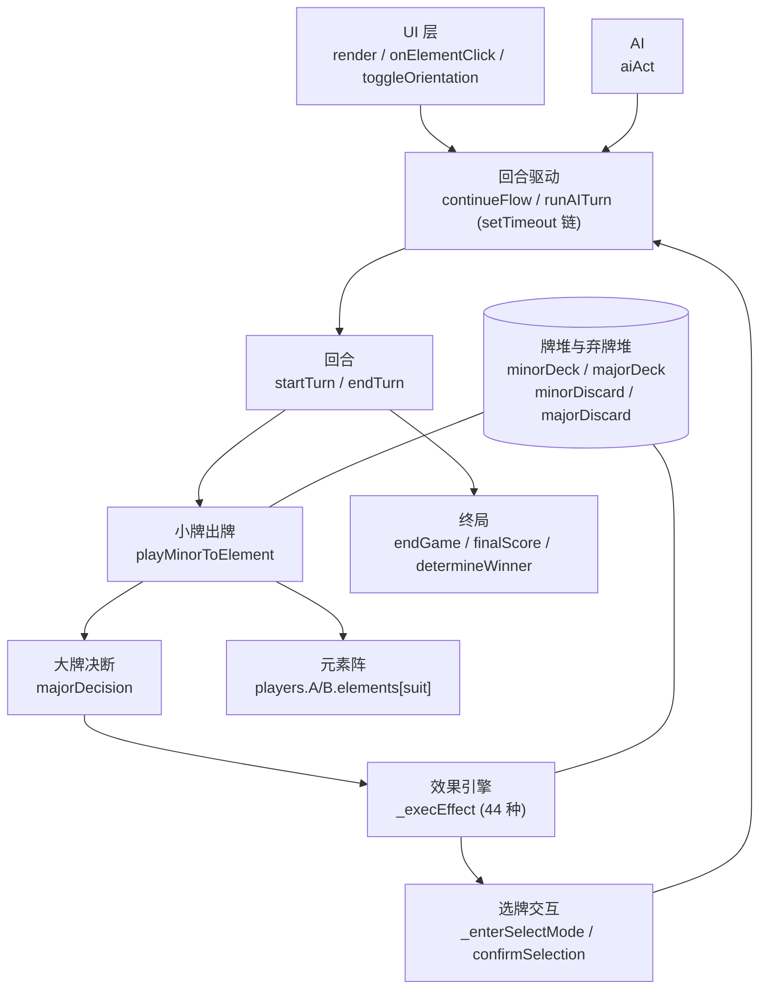

# 塔罗对决「桌游原型 v4」— GDD 设计梳理（四阶段）

> **文档性质**：本文档是**设计层面的自查梳理**，不是实现说明书。目的是反向检查设计本身是否成立。
> 已实现内容的介绍、技术常量、函数索引请看 `tarot-battle-context.md`（context = 已实现内容的记录，本文档 = 设计的审查）。
>
> **标注约定**：
> `✅ 已实现` ／ `🟡 设计中·未实现` ／ `⚪ 缺失（未设计）` ／ `⚠️ 风险（已实现但存在设计问题）` ／ `[待补充]` ／ `[待核实]`
>
> **重要免责**：本次梳理**未逐行阅读 `tarot-battle.html` 源码**，所有「已实现」判断均基于 `tarot-battle-context.md` 的记载 + 用户口头确认。凡涉及代码内部行为的结论，一律标注 `[待核实]`，需后续对源码确认。
>
> **梳理日期**：2026-10-26

---

## 0. 一页速览

### 0.1 一句话概念

双人轮流抽牌的塔罗主题桌游：小阿尔卡纳（56 张）打入 4 个元素阵稳定计分，抽到宫廷牌时额外抽一张大阿尔卡纳（22 张 × 正逆位 = 44 种一次性效果）制造局势突变，小牌堆耗尽后逐阵 PK，总分高者胜。

### 0.2 四阶段成熟度

| 阶段 | 成熟度 | 判断依据 |
|---|:--:|---|
| ① 概念 | ★★★★☆ | 类型/平台/核心概念/核心循环清晰；缺目标用户与对标作品 |
| ② 顶层设计 | ★★★☆☆ | 3 条设计目标可作支柱、v3→v4 取舍有明确理由；缺单局时长实测、难度分档、平局规则论证 |
| ③ 架构设计 | ★★★☆☆ | 单 class 状态集中、效果数据驱动；但效果引擎与 UI 耦合、无配置外置、无测试 |
| ④ 系统设计 | ★★★★☆ | 44 效果规则完整、平衡性已有 18 条审查结论；短板在 AI 决策维度极窄 |

### 0.3 最需要你先看的 3 个设计风险

**R1 — 效果丰富度没有转化为决策深度**
v4 把所有效果统一为「一次性即时生效」后，44 种效果看起来很丰富，但玩家的**实际决策点只有三类**：①把牌打进哪个阵 ②大牌打出还是弃掉 ③正位还是逆位。选牌模式（`select_card`）里的选择，多数是「从系统给的候选里选一张」，属于执行层而非策略层。→ 与支柱「用大小牌分离创造策略」存在张力，需你判断这是否可接受。

**R2 — 约 1/4 的效果数值失准，胜负可能由抽牌运气主导**
`context §3.3` 已列出：4 张「必须削」（6U 恋人、3U 女皇、15U 恶魔、17U 星星）+ 8 张「必须加强」（10U/10R 命运之轮、1U/1R 魔术师、17R 星星、3R 女皇、8R 力量、12R 倒吊人）。44 个效果里 12 个有问题 ≈ 27%。抽到强牌与弱牌的期望值差距过大时，单局结果主要由牌运决定，会直接削弱支柱 P1。

**R3 — AI 不评估效果强度，因此无法验证「玩家决策是否有意义」**
AI 固定「85% 打出大牌、70% 选正位、打进己方领先最多的阵」，它**不知道 6U 强、10U 弱**，也不会因效果内容改变打法。这意味着：即使玩家做出完全相同的决策，输赢仍高度依赖牌序。当前 AI 无法作为「玩家策略是否有效」的验证标尺。

---

## 第一部分 概念阶段

### 1.1 现状（事实）

| 维度 | 现状 | 来源 |
|---|---|---|
| 类型 | 塔罗主题双人对战桌游 | concept §1.1 |
| 平台 | 网页（单文件 HTML，浏览器直接打开） | concept 头部 |
| 视角 | 人 vs AI（玩家固定为 A，AI 为 B） | concept §1.1 / `currentPlayer: 'A'|'B'` |
| 核心概念 | 大小牌分离：小牌稳定计分 + 大牌突发事件 | concept §1.2 |
| 玩法动词 | 抽牌 / 出牌（选阵）/ 决断（大牌打出或弃掉）/ 正逆位切换 / 终局结算 | concept §2.1 §2.3 |
| 单局结构 | 56 张小牌轮流打完即终局（约 56 回合） | concept §2.3 |
| 单局时长 | 10-15 分钟（**设计估算，未经实测**） | concept §1.3；实测状态 `[待补充]` |
| 差异化 | 44 种一次性效果提供高重玩性 | concept §1.3 |
| 核心循环 | 抽 → 打 → 结算，**单局制，无局外成长** | concept §5 |
| 内容体量 | 56 小牌 + 22 大牌（×2 正逆 = 44 效果）+ 4 元素阵 | concept §2.1 §2.2 |
| 胜利条件 | 4 阵逐阵 PK，总分高者胜 | concept §3.1 |

### 1.2 缺口与建议（我的判断）

- **⚪ 目标用户完全缺失**。文档从未回答「做给谁玩」：塔罗爱好者？桌游玩家？还是纯自娱原型？这直接决定后面两个问题：44 种效果是否需要向新玩家解释、单局 10-15 分钟是否合适。`[待补充]`
- **⚪ 对标作品缺失**。没有写「参考了什么」「和它比强在哪」。塔罗主题桌游已有若干实现，缺对标就无法判断差异化是否真实成立。
- **⚠️ 「重玩性」的来源被误判**。概念把高重玩性归因于「44 种效果」，但 44 种效果的作用是**局内变量**，不是让玩家"想再玩一局"的动力。重玩性通常来自：不同的开局/牌组构筑、成就与解锁、对手难度、或玩家间的博弈深度。当前三者皆无 → **单局结束后的「再来一局」动机没有被设计**。
- **⚠️ 概念里没有「玩家在做什么决策」的一句话**。概念描述的是**流程**（抽牌→打牌→结算），不是**决策**。缺少这一句，第②阶段就无法推导出支柱。我按现有信息提炼为「把有限的牌放进对的阵，并为突发事件做取舍」，但这是我的归纳，不是你的原话。`[待补充]`

---

## 第二部分 顶层设计

### 2.1 现状（事实）

#### 设计支柱（3 条，由 concept §1.3 的「设计目标」提炼）

| # | 支柱 | 原文依据 |
|---|---|---|
| P1 | **大小牌分离制造「稳定 + 突发」的双层策略** | "用塔罗牌的大小牌分离机制创造'稳定出牌 + 突发事件'的策略" |
| P2 | **高重玩性**（44 种效果） | "大牌正/逆位提供 44 种不同的一次性效果，高重玩性" |
| P3 | **节奏可控的短局** | "单局约 10-15 分钟（56 张小牌轮流打出）" |

> 注：这 3 条在原文中叫「设计目标」，是否等同于「设计支柱」由你后续确认。我按支柱处理，因为二者在本项目中指向同一件事。

#### 关键设计取舍（有据可查的）

**取舍 1：v3 → v4 砍掉全部持续性 / 触发型大牌，只保留一次性效果**（最重要的一次取舍，理由已由用户口述补充）

> **理由（用户 2026-10-26 确认）**：持续效果与触发效果要求玩家**持续记忆场上正在生效的大牌**；而 44 种大牌效果本身已需要玩家每次查表，两重记忆叠加后玩家无法实时掌握当前战场状态，实际可操作性差。
>
> **本质**：用「效果复杂度」换「战局可读性」——把「需要同时追踪的状态量」压到零残留。

- **代价（我的补充，非用户原话）**：场面不再有大牌残留 → 失去「构筑感」与「长线博弈」（无法围绕一张持续生效的大牌做多回合布局），所有大牌都退化为瞬时的分数摆动。这个代价是否值得，取决于 P1「策略」到底指"每手选择"还是"整局长线规划"。
- 同期变更：元素阵从 `cards + activeMajor + majorHistory + lockedScore` 简化为 `cards + score`；终局从「皇帝锁分 + 太阳判定 + 世界判定 + 皇帝加分」简化为逐阵 PK；代码量 ~2740 行 → ~2100 行。

**取舍 2：小牌与宫廷牌都必须在同花色元素阵打出**（2026-07-10 调整）
- 早期宫廷牌可任意选阵，后统一为「必须同花色」。→ 减少了「宫廷牌该放哪」这个决策点，换取规则一致性。

**取舍 3：弃牌堆按小牌/大牌分离，且从弃牌堆抽牌前先洗牌**
- 支撑教皇正位（5U）、审判正位（20U）等「从弃牌堆取牌」的效果。
- 小牌堆 / 大牌堆仅在开局洗牌，后续顺序固定 → 保证牌序可预测性（对"信息博弈"有利，但玩家无法感知顺序，见 R1）。

**取舍 4：终局结算简化**
- v3 的多重特殊判定（皇帝锁分、太阳判定、世界判定）全部移除，改为「4 阵逐阵 PK，胜者 1 分，平局 0 分」。

#### 核心循环

| 层级 | 现状 |
|---|---|
| 局内（单回合） | 抽 1 小牌 →（宫廷牌则再抽 1 大牌）→ 选阵打出 → 若有大牌则决断「打出/弃掉」→ `endTurn` 切人 |
| 单局 | 循环 56 次 → 小牌堆空 → `finalScore` 逐阵 PK → 宣布胜者 |
| 长期 | **无**（无解锁、无难度进阶、无牌组构筑、无成就） |

#### 进度与内容体量

| 项 | 现状 |
|---|---|
| 难度曲线 | **无**。AI 参数固定（85% 打出 / 70% 正位 / 领先阵优先），只有一档 |
| 内容体量 | 56 小牌 + 22 大牌 × 2 = 44 效果；4 元素阵 |
| 单局长度 | 固定 56 回合（不随局势变化） |
| 平衡基准 | `context §3.3` 已有 18 条审查结论（🔴4 / 🟡2 / 🔵8 / 🟢4） |

### 2.2 缺口与建议（我的判断）

- **⚠️ P1 与 v4 的实现方式存在张力（本阶段最大问题）**。诉求是「策略」，但砍掉持续/触发后，局面变成了纯粹的「瞬时分数加减」。原因推导：所有效果都不留痕迹 → 玩家无法围绕一个状态做多回合规划 → 每回合的决策彼此独立 → **策略深度上限被锁死在「单回合最优选择」**。这是取舍 1 的必然结果，不是 bug。是否接受，取决于你要的是"轻量桌游"还是"有深度的策略桌游"。

- **⚠️ 决策点数量需要正视**。全部 44 种效果中，玩家真正的自主选择可归为三类（选阵 / 打不打大牌 / 正逆位）。其余操作（从候选牌里选 1 张、按顺序打两张）都是执行层。**若目标是"策略游戏"，需要增加「不可逆的长期承诺」类决策**（例如某种会持续影响后续回合的资源），而这恰好是取舍 1 主动放弃的东西 → 两个目标互斥，需你定优先级。

- **⚠️ 平衡性结论尚未落地为设计基线**。§3.3 的 18 条建议目前只是「建议」，没有说明哪些被采纳。在它落地前，44 个效果的实际强度分布是未知的 → 任何关于"策略 vs 运气"的讨论都缺基线。这批建议是否算你认可的设计基准，`[待补充]`。

- **🟡 缺难度分档**。当前只有一档 AI。若目标是 P3（10-15 分钟短局），至少需要「新手 / 标准」两档，否则新玩家第一局必输（AI 85% 会打出大牌，而新玩家不知道效果）。

- **⚪ 缺单局时长的验证方式**。10-15 分钟是估算。实际 = 56 回合 ×（玩家思考 + AI setTimeout 链 + 动效 0.52s）。动效本身可能就占掉可观时间，需实测。`[待补充]`

- **⚪ 平局规则偏向先手，未论证**。规则为「总分平局 → 依次比较阵总点数 → 先手方 A 胜」。推导边界：若 4 阵全部平局（总分 0:0），则阵总点数必然相等 → 直接判 A 胜。此时 B 没有任何翻盘路径。概率与公平性均未论证。`[待补充]`

- **⚪ 纯单局制是否为刻意定位**。没有局外成长，可能是"桌游原型"的合理定位（做减法），也可能是尚未考虑。`[待补充]`

- **✅ 取舍 1 的理由是清晰且成立的**。这一点值得肯定：它不是"因为代码简单所以砍"，而是基于「玩家认知负荷」的真实约束。这条取舍本身没有问题，问题在于它带来的副作用（见第一条）没有被显式接受。

---

## 第三部分 架构设计

### 3.1 现状（事实）

#### 总体结构

单一 `TarotGame` class 管理全部状态；`MAJOR_DEFS` 内联数组定义 22 张牌（数据驱动）；回合通过 `continueFlow()` + `setTimeout` 链驱动（异步，非帧循环）；UI 通过 `render()` 全量 `innerHTML` 重绘。`[待核实：源码结构]`



#### 分层与模块

| 层 | 内容 |
|---|---|
| 数据定义层 | `MAJOR_DEFS[22]`（每张牌含正/逆位效果定义与执行逻辑） |
| 状态层 | `minorDeck / majorDeck / minorDiscard / majorDiscard / currentPlayer / phase / drawnMinor / drawnMajor / majorOrientation / players.A/B.elements / moonHiddenCards / _pendingDrawnMajor / _deferredMajor` |
| 流程层 | `reset / startTurn / courtSelectElement / majorDecision / endTurn / continueFlow / runAITurn` |
| 效果层 | `_execEffect`（44 分支）+ `_enterSelectMode / selectCard / confirmSelection / skipSelection / _aiSelectCards` |
| 结算层 | `finalScore`（含月亮翻开 → 4 阵 PK）/ `determineWinner` |
| 表现层 | `render / renderElementContent / renderDrawArea / renderSelectionArea / buildZonePreview / showLogViewer / showGameOver` + `processFlyAnimations / executeFlyAnimation / highlightTargetZone` |
| 调试层 | `toggleDebugMode / debugRandomMinor / debugRandomMajor / debugQuickPlayMinor / onDebugSelectCard / debugToggleOrient / endDebugPlay` + `debugUsedCardIds` 防重复 |

#### 关键机制

1. **宫廷牌双牌并行出牌**：`startTurn` 抽到宫廷牌时立即再抽大牌 → `_courtDualActive` 记录玩家选择先打哪张 → 先打大牌时用 `_courtPendingMinor` 暂存宫廷牌、`_courtSkipTrigger` 防止补打时二次触发抽大牌。
2. **选牌交互模式**：4 种 `_selMode`（`pick1Major / pick1Minor / pick2Minor / pick1MinorOrSkip`）+ 候选牌数组 + `onConfirm` 回调 → 支持 10 个大牌效果从「自动选」升级为「玩家交互选」。
3. **动效队列**：`_flyAnimations[]` 记录待播放动画，双重 RAF 确保 DOM 就绪，多动画 80ms 间隔，飞行 0.52s cubic-bezier，到达后目标阵金色光晕 0.4s。

### 3.2 缺口与建议（我的判断）

- **⚠️ 效果引擎与 UI / 规则强耦合**。`MAJOR_DEFS` 把「效果文本描述」与「执行逻辑」放在同一处，且 `_execEffect` 需要直接操作实例状态、触发选牌 UI、决定后续流程。后果：**新增或调整一个效果，必须同时理解牌堆、元素阵、UI 选牌、流程控制四件事**。这是 44 效果只能靠人工审查（§3.3）而无法系统性调参的结构性原因。

- **⚠️ 无配置外置**。42 个效果（除世界正位即胜外）全部硬编码在 `MAJOR_DEFS` 内联数组中。对比本项目自身已有的 `tarotEffect.csv`、`tarot-battle-optimizing1.csv` —— **设计数据在 CSV 里，执行逻辑在代码里，两者靠人工同步**。一旦调整 §3.3 的任何一条建议，就必须改代码而非改表。

- **⚠️ 全量 `innerHTML` 重绘**。状态与视图没有中间层，任何状态变更都靠 `render()` 全量收敛。当前规模（~2300 行）可接受，但若效果继续增加、或要做动画过渡，会撞性能与闪烁问题。

- **🟡 无自动化验证**。44 效果 × 正逆位 × 边界（弃牌堆为空 / 目标阵为空 / 无符合条件的牌 / 候选不足 N 张 / 月亮暗置与终局翻开的交互）没有任何覆盖。§3.3 这类平衡审查目前只能靠人肉读表。

- **⚪ 调试模式只解决"能复现"，不解决"能验证"**。`debugUsedCardIds` 防重复抽牌 + 双方玩家操控，适合手动复现单张效果；但没有「批量跑 N 局统计胜负分布」的能力 → **无法回答"改了平衡之后是否更好"**。

- **⚠️ 文档与实现存在内部矛盾（影响架构可信度）**。`context §2.1` 说「宫廷牌在 `startTurn()` 中确认后立即抽大牌预览」，`context §9 数据流` 却说「`startTurn()` → 小牌堆 pop()（不再在此处预览大牌）」；而 2026-07-10 / 07-11 两条更新记录分别写了「移除 startTurn 中的大牌预览」和「startTurn() 中宫廷牌立即抽大牌预览」。三者无法同时成立，需对源码确认当前真实行为。`[待核实]`

---

## 第四部分 系统设计

> 本节按「规则 / 数值 / 状态机 / 边界」组织，只写设计层面必要信息；技术实现细节见 `context §2`。
> 每个系统末尾标注状态。

### 4.1 牌组系统 ✅

**构成**
- 小阿尔卡纳 56 张 = 4 花色（权杖🪄 / 圣杯🏆 / 宝剑⚔️ / 星币🪙）×（数字牌 1~10 + 宫廷牌 侍从/骑士/皇后/国王）
- 数字牌点数 = 面值（1~10）；宫廷牌固定 **10 点**
- 大阿尔卡纳 22 张（0 愚人 ~ 21 世界），每张含正位 / 逆位两种效果 = **44 种效果**

**规则**
- 打出约束：数字牌与宫廷牌**都必须**打入相同花色的元素阵
- 弃牌堆分离：`minorDiscard` / `majorDiscard`；从弃牌堆取牌前**先洗牌**
- 洗牌时机：两大牌堆仅开局洗一次，之后顺序固定（不可预测但确定）
- 大牌全部为**一次性**：打出即执行并弃入 `majorDiscard`

**边界**
- 小牌堆 `length === 0` → 立即 `endGame`
- 大牌堆耗尽时的行为：文档未定义 `[待核实]`

**设计观察（⚠️）**
- 宫廷牌 16 张（4 花色 × 4）占 56 张的 **28.6%**，每张固定 10 点 vs 数字牌均值 5.5 → 抽到宫廷牌既是「高分」又是「获得大牌机会」，双重收益。§3.3 已提出「降为 8 点或减少宫廷牌数量」的建议（优先级 💡可选）。这个结构性偏置是否合理，需你判断。

### 4.2 元素阵系统 ✅

**构成**
- 4 个元素阵 ↔ 4 花色；双方各占一边 → 场上共 **8 个阵**
- 每阵属性：`cards[]`（己方已打出的小牌）+ `score`（点数之和）

**规则**
- 数字牌只能进本命阵；宫廷牌同样受此约束（2026-07-10 调整）
- 「无视元素」类效果（8 种涉及）可把牌移入非本命阵

**边界**
- 阵可以为空（记分 0）
- 无视元素效果造成「花色与阵不匹配」后的终局计分：现行规则按「牌所在阵」计分；§3.3 建议改为「按实际花色阵计分」（优先级 💡可选），未采纳

**设计观察（⚠️）**
- 4 个阵 × 双方 = 8 个独立记分单位，终局 PK 是**逐阵独立**的 → 存在「弃车保帅」策略空间（牺牲一个阵换两个阵），这是当前 v4 里**为数不多的真实策略深度来源**，但文档未把它写成设计意图。

### 4.3 回合系统 ✅

**状态机**

```
phase:
  play_minor     ← 待打出小牌（数字牌直接选阵）
  play_major     ← 宫廷牌触发，待决断大牌「打出 / 弃掉」
  select_card    ← 大牌效果要求玩家从候选牌中选牌
  game_over      ← 终局
```

**回合流程**

| 步 | 行为 |
|---|---|
| 1 | `startTurn()` → 从 `minorDeck` 抽 1 张小牌 |
| 2 | 若为宫廷牌 → 立即从 `majorDeck` 再抽 1 张大牌（**双牌并行展示**） |
| 3 | 数字牌 → 玩家/AI 选阵打出 → `endTurn()` |
| 4 | 宫廷牌 → 玩家选择先打哪张：<br/>· 先打宫廷牌 → 打出小牌 → 保留大牌 → `phase='play_major'` → 决断大牌<br/>· 先打大牌 → 执行效果 → `_courtPendingMinor` 暂存 → 补打宫廷牌 |
| 5 | 大牌效果若需选牌 → `_enterSelectMode` → 玩家点击候选 → `confirmSelection` |
| 6 | `endTurn()` → 切换玩家 → 循环 |

**终局触发**：`minorDeck.length === 0` 时立即进入 `endGame()`（不等待回合自然结束）

**设计观察（⚠️）**
- 回合结构是「抽到什么打什么」，**没有手牌**。玩家不存在「攒牌 / 保留到关键时机」的决策 → 这是 R1（决策维度窄）的制度性原因之一。塔罗桌游本身也可以做成有手牌的形态，当前选择是"无手牌、纯流牌"。
- 宫廷牌的双牌并行顺序选择（先小后大 / 先大后小）**是当前唯一的顺序性决策**，但两种顺序在多数情况下结果等价（除非大牌效果影响小牌落点），实际决策价值有限。

### 4.4 记分与终局 ✅

**记分规则**

| 环节 | 规则 |
|---|---|
| 小牌点数 | 数字牌 = 面值（1~10）；宫廷牌 = 固定 10 |
| 阵总分 | 阵中所有小牌点数之和 |
| 终局 PK | 4 阵逐阵比大小，胜者得 1 分，平局无人得分 |
| 总分平局 | 依次比较「阵总点数」→ 若仍相同 → 先手方 A 胜 |

**边界**
- 月亮正位（18U）的暗置牌在终局 `finalScore` 中翻开后参与计分
- 世界正位（21U）触发「本局立即胜利」，跳过终局 PK

**设计观察（⚠️）**
- 分数分布：4 阵 → 最多 4 分，可能 2:2（比阵总点数）、1:1 或 0:0（全平）
- **0:0 全平路径**：4 阵全平 → 总分 0:0 → 阵总点数必然相等 → 判 A 胜。B 无任何翻盘路径。这条路径的概率与公平性未论证。
- 逐阵 PK 使「赢得多」与「赢得漂亮」解耦：赢 4 阵各 1 点 = 赢 1 阵 40 点，都只得 1 分。→ 这弱化了「点数积累」的意义，也让很多大牌效果（纯位移/纯旋转）显得无意义（见 4.5）。

### 4.5 大牌效果引擎 ✅（含 🟡 平衡待落地）

**机制**
- `MAJOR_DEFS[22]`：每张牌含 `upright` / `reversed` 两个定义
- 全部 `type = 'instant'`：`majorDecision(play, element, orientation)` → `_execEffect` → 弃入 `majorDiscard`
- 10 个效果通过 `_enterSelectMode` 要求玩家交互选牌（12U / 12R / 6U / 2R / 5U / 9U / 17U / 19U / 20R 等）

**效果分类学（我的归纳，用于定位平衡问题）**

| 类别 | 本质 | 代表牌 | 平衡表现 |
|---|---|---|---|
| A 牌差型 | 净增/净减手牌数量 | 3U 女皇、6U 恋人、17U 星星、19U 太阳、20U 审判 | **过强**（卡差 = 终局分差） |
| B 位移型 | 阵间移动不改点数总量 | 1U/1R 魔术师、9R 隐士、10U/10R 命运之轮、21R 世界 | **过弱**（零收益） |
| C 破坏型 | 弃掉对手/双方牌 | 3R 女皇、4U/4R 皇帝、13R 死神、14R 节制、16U/16R 塔、12R 倒吊人 | 强弱两极（取决于条件是否易达成） |
| D 夺取型 | 直接把对方面板转为己方 | 15U 恶魔、8U 力量、17R 星星 | **严重过强** |
| E 洗混型 | 洗混后重分配 | 7R 战车、14U 节制、17R 星星 | 中性（不改变总量，只改变分布） |
| F 特殊胜 | 直接获胜 | 21U 世界（全部阵含 1~10） | **过弱**（触发率 <2%） |

> **这个分类能解释 §3.3 的 18 条结论中的绝大多数**：A/D 类过强，因为「逐阵 PK 只看谁点数高」→ 单阵的净增/净减直接等价于 1 分；B 类过弱，因为旋转/位移在不改变总数时几乎不影响"谁点数高"的判定。

**边界**
- `_pendingDrawnMajor`（倒吊人/教皇逆位待选大牌）、`_deferredMajor`（12R 延迟至敌方回合）
- `skipCourtTrigger` 控制补打宫廷牌时是否二次触发抽大牌

**状态**：效果规则 ✅ 完整；平衡结论 🟡 停留在建议（§3.3，18 条未落地）

### 4.6 AI 对手 ✅

**参数**

| 决策 | 规则 |
|---|---|
| 大牌打出率 | 85% 打出 / 15% 弃牌 |
| 正逆位 | 70% 正位 / 30% 逆位 |
| 目标阵 | 选己方分数领先最多的阵；全落后则随机 |
| 选牌 | `_aiSelectCards` 自动选 |

**设计观察（⚠️ 本系统是最大短板）**
- **AI 不理解效果**。它不知道 6U 是「免费顶级大牌」、10U 是「几乎浪费」，也不知道 15U 能造成 40-50 点净摆动。→ 大牌的"威力差异"在 AI 侧完全不存在。
- **正逆位 70/30 与效果强度无关**。而正逆位在很多牌上是质变（如 10U/10R 都是弱，但 15U/15R 差异巨大）。
- **目标阵只看分数领先**，不考虑「这个阵能不能守住」「敌方哪个阵即将反超」。
- **推论**：AI 的有效决策维度 ≈ 1（选阵）。这意味着对局质量主要由**牌序**决定，玩家无法通过技巧获得稳定优势 → **当前 AI 无法验证「玩家策略是否有效」**，这是设计验证层面最需要补的一环。

### 4.7 界面与交互 ✅

**布局**：上下双行分离（上=敌方 B，下=己方 A），每行 4 阵；上方顶部栏（行动次数 / 当前玩家 / 剩余牌数 / 日志入口），下方抽牌区 + 操作栏。

**交互规则**
- 玩家只能点击己方 4 阵；非法阵（花色不符）置灰
- 宫廷牌双牌并行展示 → 点击选择先打哪张
- 正逆位预览：点击 ☀️/🌑 切换
- 弃大牌：独立按钮
- AI 回合 `setTimeout` 链自动执行，"AI思考中"提示

**辅助功能**：日志弹窗（最近 3 条常驻 + 完整弹窗）、调试模式（双方玩家操控 + AI 暂停 + 4 个调试按钮 + `debugUsedCardIds` 防重复）

**表现**：卡牌飞行动效（0.52s cubic-bezier）+ 目标阵金色光晕 0.4s

**设计观察**
- ✅ 界面结构直接映射了「8 个阵」这个核心数据结构，无多余层级 —— 这是本项目做得扎实的部分。
- ⚠️ 44 种效果在界面上**只靠一段文字描述**呈现。玩家每次抽到大牌都要重新读一遍描述来理解效果，与取舍 1 的理由（"每次去查询"）同源 —— 取舍 1 解决了"场上残留记不住"，但没有解决"效果本身记不住"。

### 4.8 系统缺口与建议汇总

| # | 系统 | 状态 | 问题 |
|---|---|:--:|---|
| S1 | 牌组 | ✅ | 宫廷牌 16 张 × 10 点带来结构性偏置（既是高分又是大牌机会） |
| S2 | 元素阵 | ✅ | 8 个独立记分单位 → "弃车保帅"策略空间存在但未被写成设计意图 |
| S3 | 回合 | ⚠️ | 无手牌 → 无"攒牌/择时"决策；唯二的顺序决策（先小先大）多数情况等价 |
| S4 | 记分 | ⚠️ | 0:0 全平直接判先手胜，B 无翻盘路径；逐阵 PK 使点数积累意义被稀释 |
| S5 | 效果引擎 | 🟡 | 44 效果规则完整，但 12/44 数值失准（§3.3 未落地）；结构上完全耦合 |
| S6 | AI | ⚠️ | 不评估效果强度，决策维度 ≈ 1，无法作为策略有效性的验证标尺 |
| S7 | 界面 | ⚠️ | 效果仅靠文字描述，玩家需反复阅读（与取舍 1 同源问题未完全解决） |
| S8 | 难度 | ⚪ | 无分档 |

---

## 附录 A 设计自检清单

> 按「你先需要拍板」的顺序排列。

| # | 项目 | 阶段 | 状态 | 风险 | 备注 |
|---|---|---|:--:|:--:|---|
| A1 | 44 效果丰富度未转化为决策深度 | ② | ⚠️ | 高 | 取舍 1 的必然结果，需你定优先级 |
| A2 | 12/44 效果数值失准，胜负或由牌运主导 | ②④ | 🟡 | 高 | §3.3 的 18 条建议是否作为设计基线待确认 |
| A3 | AI 无法验证玩家策略有效性 | ④ | ⚠️ | 高 | 决策维度 ≈ 1 |
| A4 | 核心循环无局外层，「再来一局」动机未设计 | ② | ⚪ | 中 | 是否为刻意的单局桌游定位 |
| A5 | 目标用户、对标作品缺失 | ① | ⚪ | 中 | 影响 44 效果的可解释性与时长合理性 |
| A6 | 平局判先手胜，0:0 时 B 无翻盘路径 | ④ | ⚪ | 中 | 公平性未论证 |
| A7 | 无难度分档 | ② | ⚪ | 中 | 新玩家首局必输 |
| A8 | 单局 10-15 分钟未经实测 | ① | ⚪ | 低 | 动效 0.52s × 56 回合需计入 |
| A9 | 宫廷牌 16 张 × 10 点的结构性偏置 | ④ | ⚠️ | 中 | §3.3 建议降为 8 点（💡可选） |
| A10 | 无手牌导致缺"择时"类决策 | ④ | ⚠️ | 中 | 制度性锁定，改造成本高 |
| A11 | 效果全部硬编码，与 CSV 设计数据人工同步 | ③ | ⚠️ | 中 | 调整平衡必须改代码 |
| A12 | 无自动化验证，平衡改动无法回归 | ③ | 🟡 | 中 | 无法回答"改完是否更好" |
| A13 | 效果仅靠文字描述呈现 | ④ | ⚠️ | 低 | 与取舍 1 同源问题 |
| A14 | 文档内部矛盾：大牌预览发生在 startTurn 还是 playMinorToElement | ③ | ⚠️ | 低 | `[待核实]` |

---

## 附录 B 数据来源与可信度

**本次梳理的事实来源分级**：

| 代码 | 含义 |
|---|---|
| `[D]` | `tarot-battle-context.md` 文档记载 |
| `[U]` | 用户 2026-10-26 会话口头确认 |
| `[I]` | 我的推断 / 归纳（非原文，可信度中等） |
| `[N]` | 缺失，项目内无据可查 |

**逐项对照**：

| 内容 | 来源 | 说明 |
|---|:--:|---|
| 类型 / 平台 / 视角 / 核心概念 | `[D]` | context §1.1 §1.2 |
| 56 小牌 / 22 大牌 / 44 效果 | `[D]` | context §2.1 |
| 出牌约束（同花色） | `[D]` | context §2.1 + 2026-07-10 更新记录 |
| 弃牌堆分离与洗牌 | `[D]` | context §2.1 |
| 回合流程 / 4 种 phase | `[D]` | context §2.3 §7 |
| 记分与终局规则 | `[D]` | context §3.1 |
| AI 参数（85% / 70% / 领先阵） | `[D]` | context §3.2 |
| 18 条平衡建议 | `[D]` | context §3.3 |
| **v4 砍掉持续/触发型效果的理由** | `[U]` | 2026-10-26 用户口述，**此前项目内无任何记录** |
| 设计支柱 P1~P3 | `[I]` | 由 context §1.3 的"设计目标"提炼，非原文表述 |
| 效果分类学（A~F 六类） | `[I]` | 我的归纳，用于定位平衡问题 |
| 「决策维度只有三类」的判断 | `[I]` | 基于 44 效果速查表逐条分析得出 |
| 「缺手牌导致缺择时决策」 | `[I]` | 基于回合流程推导 |
| 0:0 全平判 A 胜的边界推导 | `[I]` | 由 §3.1 规则逻辑推导，非文档明写 |
| 目标用户 | `[N]` | 全项目缺失 |
| 对标作品 | `[N]` | 全项目缺失 |
| 单局时长实测 | `[N]` | 仅有 10-15 分钟估算 |
| 难度分档计划 | `[N]` | 无记录 |
| 纯单局制是否刻意 | `[N]` | 无记录 |
| 18 条平衡建议的采纳状态 | `[N]` | 无记录 |

**已发现的文档内部矛盾（需后续同步文档时处理）**：

1. **文件规模描述冲突**：`context` 头部写「单文件 ~110KB / 3000+ 行」，`§10 项目文件` 写「~70KB，2300+ 行」，`§11 v3→v4 变更` 写「~2100行/70KB」。三处不一致。
2. **大牌预览时机冲突**：`§2.1/§2.3`（startTurn 中抽大牌）vs `§9 数据流`（"不再在此处预览大牌"）vs 2026-07-10 与 07-11 两条相反方向的更新记录。需对源码确认当前行为。
3. **项目缺少 `memory.md`**：`global-rules §3.3` 要求每个项目至少三份文档（context / memory / global-rules），本项目仅有 context，且文档直接放在项目根目录而非 `Documents/`。→ 本次梳理中，**所有"为什么这样设计"的问题都无据可查**，这是本文档可信度的最大限制。
