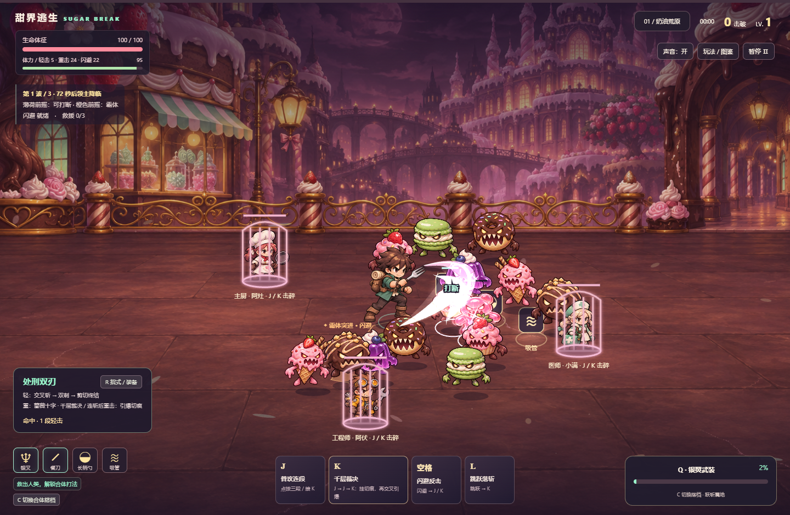

# 甜界逃生 · Sugar Break

斜俯视、纯键盘操作的甜品世界近战动作肉鸽 Demo。人类使用餐具组合对抗甜品怪物，救援同伴并发动不同的人类合体。

双击本目录的 **甜界逃生.html** 即可离线试玩，无需安装或运行服务器。

- Enter 开始闯关；T 进入全餐具、全人类开放的试招庭院。
- 方向键 / WASD 移动与朝向；J 普攻，K 重击，L 跳跃，空格闪避。
- X 切换餐具搭配，R 查看招式，C 选择合体搭档，Q 发动合体。
- 支持三段连击、闪避派生、精准闪避反击、普通打断、霸体与 Boss 破势。
- 四套单持、六套双餐具变体、三种双人合体与三关 Boss 流程。

详细玩法、已知限制与美术来源见 [试玩说明](试玩说明.md)。当前是可继续迭代的 Demo，没有存档、局外成长或联网功能。

## 构建与检查

使用 Node.js 运行：

```sh
node build.cjs
node tests/browser-check.cjs
```

构建脚本将源码和美术嵌入单个 HTML。浏览器测试目前使用 Windows 本机 Chrome 路径和 Node.js 内置 WebSocket，不需要第三方 Node 包；其他环境需修改测试脚本的浏览器启动路径。

当前运行入口是 src/action-game.js 与 src/presentation-v3.js，界面是 src/index.html。src/game.js 和旧版测试保留供历史参考，不参与当前构建入口。

测试报告见 tests/v3-report.json。通关检查使用测试控制加速；报告不代表自然玩法的完整难度平衡验证。


